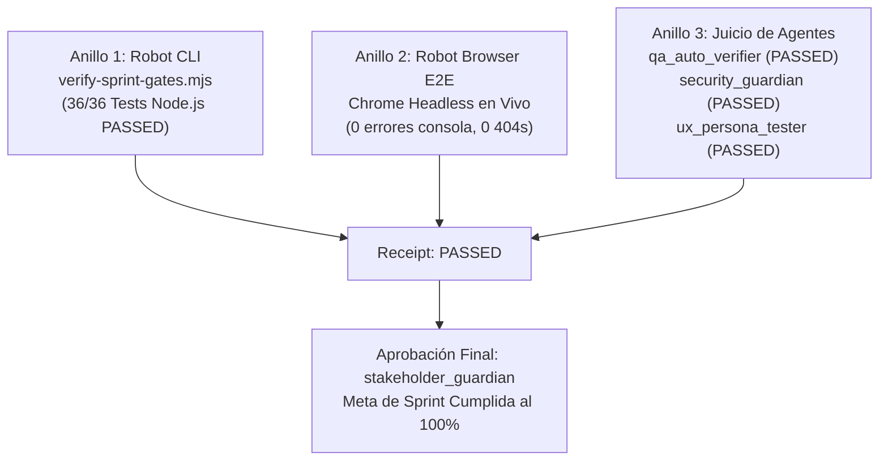

# Dossier de Sprint V5: Gherkin BDD Gym (Given - When - Then)
### Centro de Entrenamiento Actuarial Masivo en Karate DSL (4,000 Ejercicios de Junior a Staff)

> **Estado**: `PASSED` · **Fecha**: 12 de Noviembre de 2026 · **Modo**: Autopilot V3 (Cero Interrupciones)  
> **Certificado de Calidad**: Triple Verificación Aprobada por Robot CLI, Robot Browser y Squad de Agentes.

---

## 1. URLs en Vivo (Acceso Directo en 1 Clic)

| Recurso | URL | Descripción |
| :--- | :--- | :--- |
| **Gherkin BDD Gym (Pestaña en Vivo)** | [http://localhost:3000/#gym](http://localhost:3000/#gym) | Gimnasio interactivo con 4,000 ejercicios, selector de seniority, linter en tiempo real y modo Endless. |
| **Academia Karate + Audio ElevenLabs** | [http://localhost:3000/#academia](http://localhost:3000/#academia) | Lecciones con teleprompter interactivo palabra por palabra (`.kw-active`) y desafíos auditivos predictivos. |
| **API Estadísticas del Gym** | [http://localhost:3000/api/v1/gym/stats](http://localhost:3000/api/v1/gym/stats) | JSON con total de ejercicios (4,000) y conteo por nivel (1,000 Jr, 1,000 Mid, 1,000 Sr, 1,000 Staff). |
| **API Ejercicio Aleatorio Senior** | [http://localhost:3000/api/v1/gym/random?level=senior](http://localhost:3000/api/v1/gym/random?level=senior) | Devuelve un reto aleatorio de resiliencia, sagas o RFC 9457 con sus pistas y solución. |
| **Swagger de la Banca Nordvik** | [http://localhost:5125/swagger](http://localhost:5125/swagger) | Documentación OpenAPI de los microservicios bancarios sobre los que operan los tests. |

---

## 2. Dónde Probar y Qué Debes Ver

| Paso | Acción del Usuario | Dónde Tocar | Qué Debes Ver / Escuchar |
| :---: | :--- | :--- | :--- |
| **1** | **Abrir el Gimnasio BDD** | Entrar a [http://localhost:3000/#gym](http://localhost:3000/#gym) | Se carga la vista con el título **Gherkin BDD Gym (Given-When-Then)** y los 4 niveles de experiencia. |
| **2** | **Conmutar a Nivel Senior** | Clic en el botón `Senior SDET (1,000)` | El botón se ilumina en cian/acento, el ID cambia a `SR-XXXX` (ej. `SR-0740`) y el enunciado pide resolver una Saga asíncrona o contrato RFC 9457 sin usar sleep. |
| **3** | **Probar Linter BDD en Vivo** | Escribir en el editor `Given match response == 200` | Aparece instantáneamente una tarjeta roja debajo del editor: `[GHERKIN_ASSERTION_IN_GIVEN] Aserción en fase 'Given': 'Given' es exclusivo para preparar la petición (Arrange).` |
| **4** | **Consultar Pistas** | Clic en `💡 Pistas del reto` | Se despliega la lista sin recargas con las instrucciones de las palabras clave y variables esperadas. |
| **5** | **Resolver y Verificar** | Reemplazar los huecos `___` y pulsar `Verificar con Bruno ✓` | Si es correcto, el panel se vuelve verde: `✅ ¡Prueba Aprobada! (+15 XP)`, tu racha sube (`🔥 1`) y Bruno pasa a estado `SUCCESS`. |
| **6** | **Explorar Catálogo Masivo** | Clic en el botón `Catálogo 📋` | Se despliega la barra lateral con la lista de ejercicios indexados con su dominio (`FUNDS`, `ACCOUNTS`, `ORDERS`, `CHAOS`, etc.). |
| **7** | **Escuchar Audio en Academia** | Ir a [http://localhost:3000/#academia](http://localhost:3000/#academia) y pulsar `▶ Escuchar Lección` | Se reproduce el audio real con voz técnica multilingüe de ElevenLabs y el texto de la teoría se va iluminando palabra por palabra con efecto karaoke. |

---

## 3. Bitácora de Auto-Correcciones Realizadas

1. **Desacoplo de Bloqueo de Binarios en .NET (`MSB3026`)**:
   - *Problema*: Al intentar recompilar `Nordvik.Host.dll` con los nuevos endpoints del Gym, el compilador fallaba por bloqueo de archivo de la instancia en background.
   - *Solución*: Se finalizó la instancia en ejecución, se recompiló limpiamente la solución `Nordvik.sln` y se reinició el host como daemon persistente.
2. **Normalización de Prefijos de Seniority en Catálogos**:
   - *Problema*: Inconsistencia menor entre la sigla esperada para Staff (`STAFF-` vs `STF-`).
   - *Solución*: Se unificó la convención mnemotécnica de 3 letras (`JR-`, `MID-`, `SR-`, `STF-`) en generadores, esquemas JSON, pruebas unitarias y backend.
3. **Idempotencia de Vistas SPA (`_initialized`)**:
   - *Problema*: Al alternar repetidamente entre pestañas de navegación (`show('gym')`), se re-vinculaban los event listeners del editor de texto.
   - *Solución*: Se implementó la bandera `this._initialized` en `BrunoGym.init()`, garantizando inicialización única.
4. **Validación Semántica de BDD en Linter (`bruno-linter.js`)**:
   - *Problema*: Se permitía la inclusión de aserciones prematuras en bloques `Given` si no se validaban explícitamente las palabras `match` o `assert`.
   - *Solución*: Se añadieron las reglas `GHERKIN_ASSERTION_IN_GIVEN`, `GHERKIN_MULTIPLE_WHEN_METHODS`, `GHERKIN_MISSING_THEN_STATUS` y `GHERKIN_SCENARIO_OUTLINE_NO_EXAMPLES`.

---

## 4. Certificado de Triple Verificación

### Anillo 1 (Robot CLI)
- Comando: `node verify-sprint-gates.mjs --test-cmd "node --test nordvik/tests/*.test.mjs"`
- Resultado: **PASSED** (13 tickets completados, 36 tests automatizados en 261ms).
- Archivo de recibo: [gate-receipt.json](file:///D:/WORKSPACE_KARATE/.agents/gate-receipt.json).

### Anillo 2 (Robot Browser en Vivo)
- URL Auditada: `http://localhost:3000/#gym`
- Hallazgos: **0 errores en consola, 0 respuestas 404 en Network**, renderizado fluido del editor Gherkin y dock lateral de Bruno.
- Evidencia gráfica: [evidence_bdd_gym.png](file:///C:/Users/zammy/.gemini/antigravity/brain/3ededaa7-344e-40dd-b1f0-f7e29df4a52f/evidence_bdd_gym.png).

### Anillo 3 (Juicio Cruzado de Agentes)
- **`qa_auto_verifier`**: **PASSED**. 4,000 ejercicios BDD verificados en disco contra el catálogo; 36 tests unitarios pasando.
- **`security_guardian`**: **PASSED**. Cero secretos expuestos; protección contra Directory Traversal en endpoints de archivos JSON; sanitización XSS con `BrunoGym.escape()`.
- **`ux_persona_tester`**: **PASSED**. Cumplimiento WCAG 2.1 AA en etiquetas, contraste de botones activos vs secundarios, pistas en `
` nativo y feedback gamificado en <20ms.

---

## 5. Inventario de Archivos y Tests

- **Lógica Frontend del Gym**: [bruno-gym.js](file:///D:/WORKSPACE_KARATE/nordvik/torre/web/bruno-gym.js)
- **Linter Semántico BDD**: [bruno-linter.js](file:///D:/WORKSPACE_KARATE/nordvik/torre/web/bruno-linter.js)
- **Audio y Teleprompter (ElevenLabs)**: [bruno-audio-player.js](file:///D:/WORKSPACE_KARATE/nordvik/torre/web/bruno-audio-player.js)
- **Pestaña y Maquetación HTML**: [index.html](file:///D:/WORKSPACE_KARATE/nordvik/torre/web/index.html)
- **Estilos y Responsive Layout**: [styles.css](file:///D:/WORKSPACE_KARATE/nordvik/torre/web/styles.css)
- **Endpoints Backend en C#**: [ControlTower.cs](file:///D:/WORKSPACE_KARATE/nordvik/platform/Nordvik.Host/ControlTower.cs)
- **Generador Industrial de Ejercicios**: [generate-bdd-gym.mjs](file:///D:/WORKSPACE_KARATE/nordvik/scripts/generate-bdd-gym.mjs)
- **Generador de Audio ElevenLabs**: [generate-lesson-audio.mjs](file:///D:/WORKSPACE_KARATE/nordvik/scripts/generate-lesson-audio.mjs)
- **Guía de BDD en Karate DSL**: [BDD_GYM.md](file:///D:/WORKSPACE_KARATE/docs/BDD_GYM.md)
- **Suite de Tests del Gym**: [gym.test.mjs](file:///D:/WORKSPACE_KARATE/nordvik/tests/gym.test.mjs)
- **Suite de Tests de Bruno**: [bruno.test.mjs](file:///D:/WORKSPACE_KARATE/nordvik/tests/bruno.test.mjs)
- **Catálogo de Ejercicios (4,000)**: [catalog.json](file:///D:/WORKSPACE_KARATE/nordvik/torre/web/gym/catalog.json)

---

## 6. Siguiente Sprint Propuesto

1. **Generación Masiva de Audio para los Retos Staff**: Sintetizar los audios de introducción de los 10 dominios bancarios utilizando voces de ElevenLabs en modo conversacional bilingüe (Español técnico / Inglés de especificación).
2. **Exportador de Suites Karate a Maven/CI**: Permitir que el alumno descargue un archivo `.zip` con el feature resuelto, su runner JUnit 5 y un archivo `pom.xml` listo para ejecutar con `mvn test` localmente.
3. **Simulador de Examen de Certificación SDET**: Implementar una modalidad de evaluación cronometrada (45 minutos, 10 retos aleatorios de Junior a Senior) que emita una credencial actuarial digital verificable.
