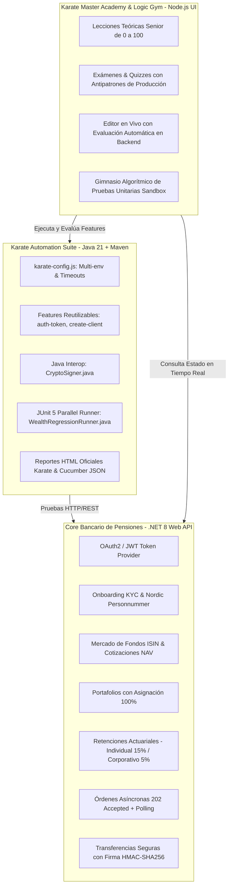

# 🏛️ Söderberg & Partners Wealth & Pension - Karate SDET Enterprise Simulator

[](https://github.com/karatelabs/karate)
[](https://dotnet.microsoft.com/)
[](https://openjdk.org/)
[](https://nodejs.org/)

Simulador integral de pruebas automatizadas y core financiero para la formación de **SDETs Senior** en **Karate Framework DSL**, APIs bancarias/pensiones de alta complejidad, y patrones de arquitectura empresarial heredados (10+ años).

---

## 📍 Ubicación en Disco Local

| Recurso | Ruta Local en Disco |
| :--- | :--- |
| **Directorio Raíz del Workspace** | `D:\WORKSPACE_KARATE` |
| **Core Bancario .NET 8** | `D:\WORKSPACE_KARATE\soderberg-wealth-api` |
| **Suite de Pruebas Karate DSL** | `D:\WORKSPACE_KARATE\karate-test-suite` |
| **Academy & Gym de Depuración** | `D:\WORKSPACE_KARATE\karate-debug-bot` |
| **Lanzador en 1-Clic** | `D:\WORKSPACE_KARATE\start-environment.bat` |

---

## 🔗 Repositorio Remoto en GitHub

- **URL del Repositorio:** [https://github.com/ZammyTech-online/karate-wealth-sdet-simulator](https://github.com/ZammyTech-online/karate-wealth-sdet-simulator)
- **Clonación HTTPS:**
  ```bash
  git clone https://github.com/ZammyTech-online/karate-wealth-sdet-simulator.git
  ```

---

## 🏗️ Arquitectura del Ecosistema



---

## 📂 Estructura Detallada del Proyecto

```text
D:\WORKSPACE_KARATE\
├── README.md                           # Documentación técnica completa
├── start-environment.bat               # Script para iniciar backend y bot en Windows
│
├── soderberg-wealth-api/               # BACKEND .NET 8 (Core Bancario)
│   ├── Program.cs                      # Endpoints REST, Auth JWT, Swagger, Validaciones
│   ├── SoderbergWealthApi.csproj       # Dependencias NuGet (JwtBearer, Swagger, etc.)
│   └── appsettings.json                # Configuración de Kestrel y logging
│
├── karate-test-suite/                  # AUTOMATION FRAMEWORK KARATE
│   ├── pom.xml                         # Dependencias Maven (Karate JUnit 5, Cucumber Reporting)
│   └── src/test/
│       ├── resources/
│       │   └── karate-config.js        # Configuración multi-entorno (local, dev, staging)
│       └── java/com/soderberg/qa/
│           ├── WealthRegressionRunner.java # Runner JUnit 5 con ejecución en paralelo
│           ├── helpers/
│           │   └── CryptoSigner.java   # Helper Java para cálculo criptográfico HMAC-SHA256
│           ├── reusable/
│           │   ├── auth-token.feature  # Generador de Bearer tokens con llamada optimizada
│           │   └── create-client.feature # Creador dinámico de clientes con Personnummer sueco
│           └── features/
│               ├── basics/
│               │   └── 01_funds_catalog.feature      # Nivel 00: HTTP, Fuzzy matchers, regex
│               ├── reusability/
│               │   └── 02_client_lifecycle.feature  # Nivel 25: call vs callonce, 409 & 422
│               ├── async_orders/
│               │   └── 03_async_rebalance.feature   # Nivel 50: Polling bancario (retry until)
│               └── crypto_interop/
│                   └── 04_crypto_transfer.feature   # Nivel 100: Invocación Java.type & headers
│
└── karate-debug-bot/                   # ACADEMIA INTERACTIVA Y LOGIC GYM
    ├── server.js                       # Servidor API evaluador (evalúa features en tiempo real)
    ├── package.json                    # Configuración Node.js
    ├── data/
    │   └── curriculum.json             # Currículum estructurado: Teoría, Quizzes y Retos
    └── public/
        └── index.html                  # Dashboard SPA con editor de código y runner
```

---

## 🚀 Guía de Inicio Rápido

### 1. Iniciar los Servicios
Puedes iniciar todo el entorno de dos maneras:

#### Opción A: Script Automático (Recomendado)
Haz doble clic sobre el archivo:
```text
D:\WORKSPACE_KARATE\start-environment.bat
```
O ejecútalo desde PowerShell / CMD:
```powershell
cd D:\WORKSPACE_KARATE
.\start-environment.bat
```

#### Opción B: Manualmente en Terminales Separadas
```powershell
# Terminal 1: Iniciar Backend .NET
cd D:\WORKSPACE_KARATE\soderberg-wealth-api
dotnet run --urls "http://localhost:5125"

# Terminal 2: Iniciar Karate Academy
cd D:\WORKSPACE_KARATE\karate-debug-bot
node server.js
```

---

## 🌐 Servicios Disponibles en Local

| Servicio | URL Local | Descripción |
| :--- | :--- | :--- |
| **Karate Master Academy & Logic Gym** | [http://localhost:3000](http://localhost:3000) | Editor en vivo, quizzes interactivos y unit tests algorítmicos. |
| **Documentación Swagger (.NET Core)** | [http://localhost:5125](http://localhost:5125) | Explorador interactivo OpenAPI de todos los endpoints de pensiones. |
| **Reportes HTML Oficiales de Karate** | `karate-test-suite\target\karate-reports\karate-summary.html` | Reporte nativo con tiempos de respuesta, trazas y payloads JSON. |

---

## 🧪 Ejecución de Pruebas Automatizadas desde CLI

Para correr toda la suite de regresión en paralelo desde la terminal:
```powershell
cd D:\WORKSPACE_KARATE\karate-test-suite
mvn test -Dtest=WealthRegressionRunner
```

Para correr una categoría de pruebas específica por tags:
```powershell
# Solo pruebas básicas y catálogo
mvn test -Dtest=WealthRegressionRunner "-Dkarate.options=--tags @basics"

# Solo pruebas de asincronía bancaria
mvn test -Dtest=WealthRegressionRunner "-Dkarate.options=--tags @async"

# Solo pruebas de seguridad y Java Interop
mvn test -Dtest=WealthRegressionRunner "-Dkarate.options=--tags @interop"
```

---

## 🎓 Plan de Aprendizaje: De 0 a Senior SDET

### Módulo 1: Fundamentos de APIs y Karate DSL (Nivel 0 - 25)
- Métodos HTTP (`GET`, `POST`, `PUT`, `DELETE`).
- Códigos de respuesta estándar (`200 OK`, `201 Created`, `400 Bad Request`, `404 Not Found`).
- Esquemas difusos (*Fuzzy Matchers*): `#string`, `#number`, `#boolean`, `#array`, `#regex`.
- Predicados lógicos de validación: `#? _ > 0`.

### Módulo 2: Reutilización, Scopes y Rendimiento (Nivel 25 - 50)
- Configuración global multi-entorno con `karate-config.js`.
- Diferencias críticas entre `karate.call` y `karate.callonce` (prevención de bloqueos por rate-limiting y control de concurrencia).
- Paso de argumentos aislados (`__arg`) y retorno estructurado de respuestas.
- Validación de reglas de negocio negativas (`409 Conflict`, `422 Unprocessable Entity`).

### Módulo 3: Asincronía Bancaria y Resiliencia (Nivel 50 - 75)
- Manejo de endpoints con patrón `202 Accepted`.
- Reemplazo del antipatrón `Thread.sleep` por sondeo activo (*active polling*):
  ```cucumber
  * configure retry = { count: 6, interval: 1000 }
  Given path '/api/v1/orders', orderId, 'status'
  And retry until response.status == 'COMPLETED'
  When method get
  Then status 200
  ```

### Módulo 4: Java Interop Senior y Seguridad Financiera (Nivel 75 - 100)
- Importación y ejecución de código Java dentro de Karate usando `Java.type('...')`.
- Cálculo de firmas criptográficas `HMAC-SHA256` en cabeceras `X-Signature`.
- Pruebas de regresión paralela con runners JUnit 5 personalizados y generación de reportes corporativos Cucumber.

---

## 🧠 Logic Gym (Algoritmia para SDETs)
Accede a la pestaña **Logic Gym** en [http://localhost:3000](http://localhost:3000) para practicar:
1. **Validador de Identidad Nórdica:** Expresiones regulares para `Personnummer` sueco (`YYYYMMDD-XXXX`).
2. **Asignación de Fondos:** Algoritmos de validación de balances que deben sumar exactamente 100.0%.
3. **Cálculo de Retención Actuarial:** Deducción de impuestos escalonados para pensiones individuales vs corporativas.
4. **Deep Diffing de Payloads:** Comparador semántico y recursivo de estructuras JSON complejas.

---

## 👤 Autor & Créditos
- **Organización:** Söderberg & Partners Simulation Project
- **Desarrollado para:** Capacitación y certificación práctica de SDETs Senior
- **Repositorio:** [ZammyTech-online/karate-wealth-sdet-simulator](https://github.com/ZammyTech-online/karate-wealth-sdet-simulator)
