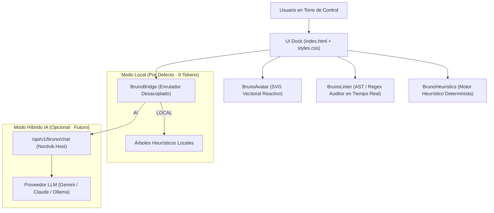

# 🤖 Bruno · El Muñeco Copiloto y Mentor SDET de Karate DSL

> **Rigor Actuarial · Cero Tests Flakies · Cero Esperas Pasivas (Sleep) · 100% Determinista**

---

## 🌟 1. Identidad y Lore de Bruno
Bruno es un stickman 2D minimalista de cabeza blanca redonda calva, camiseta negra de cuello redondo y gafas circulares con brillo neón cian. En el ecosistema de **Nordvik Wealth & Pension**, Bruno desempeña el rol de **Lead Actuarial SDET**.

Su misión es guiarte desde el **nivel 0 hasta el nivel 100** en la automatización de pruebas de APIs complejas con Karate DSL:
- **No tolera los `karate.sleep()`**: Te enseñará a usar `retry until` y a mover el reloj del sistema mediante `clock-service`.
- **Exige aserciones deterministas**: Corrige el uso de `match` para comparaciones numéricas relativas guiándote hacia la instrucción nativa `assert`.
- **Protege el aislamiento de datos**: Detecta DNI/PNRs o IBANs hardcodeados y te muestra cómo generar entidades sintéticas actuariales en memoria.
- **Domina el estándar RFC 9457**: Traduce cualquier error HTTP 400, 401, 403, 409 o 500 al contexto financiero exacto.

---

## 🏗️ 2. Arquitectura del Sistema (Zero-Token Guarantee)

Bruno está diseñado bajo una arquitectura **desacoplada e híbrida**:



### Principio de Cero Coste (Zero Tokens)
Por defecto, todo el razonamiento de Bruno ocurre en local dentro del navegador y el host:
1. **Inspección de Código en Vivo**: Al editar los ejercicios de la Academia, `BrunoLinter.audit()` analiza las líneas sin llamadas de red ni modelos generativos.
2. **Diagnóstico Post-Ejecución**: Al pulsar "Corregir lección", `BrunoHeuristics.diagnose()` analiza la salida de Maven y JUnit para explicar el fallo en lenguaje humano y sugerir la línea exacta a corregir.
3. **Avatar Reactivo**: `BrunoAvatar.render(state, size)` genera SVG puro sin imágenes pesadas ni dependencias externas.

---

## 🎭 3. Estados Reactivos del Avatar

| Estado | Expresión Visual | Significado Actuarial |
| :--- | :--- | :--- |
| **`IDLE`** | Postura neutral, gafas cyan suaves. | Esperando interacción o monitoreando la sesión en reposo. |
| **`THINKING`** | Mano en mentón, burbujas de pensamiento. | Analizando código en el linter o ejecutando la suite Karate. |
| **`EXPLAINING`** | Brazo señalando hacia adelante, boca abierta. | Explicando una norma, contrato RFC 9457 o guía de Karate. |
| **`ALERT`** | Manos a la cabeza, gafas rojas, exclamación. | Detección de antipatrones (`sleep`, colisión 409, 401 sin auth). |
| **`SUCCESS`** | Pulgar arriba, sonrisa verde, gafas esmeralda. | Todos los tests pasaron; 0 regresiones detectadas. |

---

## 🛠️ 4. Reglas del Linter y Diagnóstico Heurístico

### Reglas Estáticas de Bruno (`BrunoLinter`)
1. `ANTI_PATTERN_SLEEP`: Prohíbe terminantemente `karate.sleep()`. Solución: `retry until` o mover reloj.
2. `HARDCODED_PNR`: Detecta números personales suecos fijos (`19850412-1234`). Solución: `synthetic-person-service`.
3. `HARDCODED_IBAN`: Detecta cuentas bancarias fijas (`SE...`). Solución: `_iban.feature` con validación módulo 97.
4. `INVALID_MATCH_COMPARISON`: Detecta `* match var < umbral`. Solución: `* assert var < umbral`.

### Errores Dinámicos Soportados (`BrunoHeuristics`)
- `ReferenceError` de variables no declaradas.
- HTTP 401 Unauthorized por falta de token Bearer.
- HTTP 403 Forbidden por violación de roles RBAC.
- HTTP 409 Conflict por traspaso de pensión ya iniciado o colisión de clave de idempotencia.
- `FileNotFoundException` en llamadas a features externos (`call read`).
- `BindException` por saturación de puertos TCP efímeros en Windows.
- Marcas de hueco `___` pendientes de rellenar.

---

## 🔌 5. Conexión Híbrida a Modelos de IA en el Futuro

Para habilitar un proveedor de IA generativa (Gemini, Claude o un LLM local como Ollama), **no es necesario modificar el frontend**:
1. Pulsa el botón **"Conmutar IA"** en la cabecera de Bruno dentro de la Torre de Control.
2. El enrutador `BrunoBridge` dirigirá las preguntas al endpoint `/api/v1/bruno/chat`.
3. En `platform/Nordvik.Host/ControlTower.cs`, reemplaza el método handler de `/api/v1/bruno/chat` con tu cliente de API preferido:

```csharp
// Ejemplo de conexión con Gemini / Claude en ControlTower.cs
api.MapPost("/bruno/chat", async (HttpContext http) =>
{
    var req = await JsonSerializer.DeserializeAsync<JsonElement>(http.Request.Body);
    var question = req.GetProperty("question").GetString();
    
    // Inyectar contexto actuarial del sistema
    var systemPrompt = "Eres Bruno, Lead Actuarial SDET de Nordvik...";
    var reply = await TuServicioLLM.GenerarRespuestaAsync(systemPrompt, question);

    return Results.Ok(new { source = "AI", reply, status = "SUCCESS" });
});
```

Si el servidor IA no está disponible o da error de red, `BrunoBridge` realiza automáticamente un **fallback silencioso** al motor heurístico local sin interrumpir la experiencia.

---

## 🧪 6. Ejecución de Pruebas Automatizadas

La suite completa de pruebas unitarias de Bruno se ejecuta con Node.js nativo:

```powershell
node D:\WORKSPACE_KARATE\nordvik\tests\bruno.test.mjs
```

Resultado esperado:
```
✔ BrunoAvatar: renderiza SVG válido en todos sus 5 estados
✔ BrunoHeuristics: diagnostica 8 categorías de error
✔ BrunoLinter: detecta antipatrones y datos hardcodeados
✔ BrunoBridge: conmuta entre local e IA con fallback
✔ BrunoAudioPlayer: formateo de tiempo y escape HTML
✔ Archivos de Audio ElevenLabs: L00, L01 y L02 presentes y conformes
ℹ tests 19 · pass 19 · fail 0
```

---

## 🎙️ 7. Sistema Auditivo y Predictivo con ElevenLabs (Teleprompter & Retos en Vivo)

El sistema integra locución profesional con la API oficial de ElevenLabs mediante el endpoint `/v1/text-to-speech/{voice_id}/with-timestamps`:

### Características Clave:
1. **Voz Estable de Alta Fidelidad**: Emplea el modelo `eleven_multilingual_v2` con la voz técnica de **Liam** (`TX3LPaxmHKxFdv7VOQHJ`), ofreciendo pronunciación natural en inglés para sintaxis Gherkin y contratos HTTP.
2. **Teleprompter Sincronizado Palabra a Palabra**:
   - Cada palabra leída en el audio tiene un timestamp exacto de inicio y fin en milisegundos.
   - En la Academia, la palabra activa se ilumina en **cian neón** (`.kw-active`) con scroll suave automático.
3. **Modo Predictivo Interactivo ("Bruno Te Reta")**:
   - En momentos clave de la lección, el audio se pausa automáticamente.
   - Aparece un desafío interactivo con 3 opciones sobre la sintaxis correcta.
   - Al responder correctamente, Bruno festeja (`SUCCESS`) y reanuda el audio.
4. **Pre-Generación y Caché en Disco**:
   - Los audios se generan una sola vez mediante `scripts/generate-lesson-audio.mjs` y se almacenan en `torre/web/audio/{lessonId}.mp3` y `{lessonId}.json`.
   - Se sirven de forma estática con soporte de streaming HTTP (`Accept-Ranges: bytes`), con coste 0 y consumo de tokens 0 en las reproducciones posteriores.
5. **Fallback Offline Universal**: Si una lección no cuenta con audio pre-generado, se activa el motor nativo del navegador (`Web Speech API`) sin interrumpir la experiencia.

