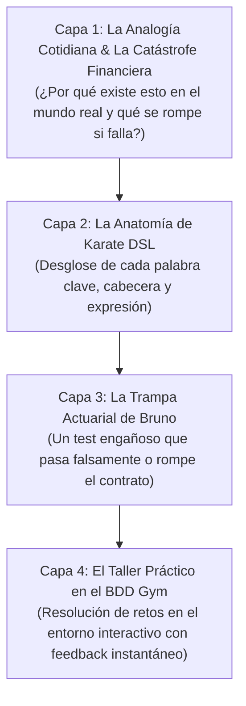

# Plan Maestro Pedagógico: Ecosistema Actuarial de Karate DSL
### Formación SDET de Alto Rendimiento: De Cero a Staff en Sistemas Financieros Críticos

---

## 1. Diagnóstico y Análisis de Abstracción

### 1.1. El Problema de la Doble Abstracción
En la automatización de pruebas para el sector asegurador, bancario y de pensiones (WealthTech / Actuarial), el ingeniero de calidad se enfrenta a dos barreras simultáneas:

1. **La Abstracción del Dominio Financiero Nórdico:**
   - Conceptos como **cálculo de NAV** (*Net Asset Value*), periodos de corte (*market cut-off*), liquidación diferida (**T+2**), retención fiscal de dividendos en cuentas protegidas (**ISK** vs **AF**), verificación de número personal sueco (**Personnummer** con algoritmo de Luhn) y orquestación de **Sagas Asíncronas** de traspaso entre fondos de pensiones.
   - Si el alumno no entiende *por qué* una operación tarda 48 horas en liquidarse o *qué catástrofe* ocurre si se cobra una comisión indebida, sus pruebas serán mecánicas, frágiles y sin criterio de negocio.

2. **La Abstracción de Karate DSL:**
   - Karate combina sintaxis Gherkin (`Given/When/Then`) con un motor de ejecución basado en GraalVM JavaScript, expresiones fuzzy (`#string`, `#regex`, `#? _ > 0`), scopes de variables desacoplados (Background vs Scenario), llamadas modulares (`karate.call`, `callSingle`), manipulación de reloj y mocks dinámicos en proceso (`karate.start`).
   - Sin una guía pedagógica gradual, los alumnos caen en los clásicos vicios de novato: abusar de `sleep()`, aserciones frágiles de texto fijo o ignorar la idempotencia.

---

## 2. El Marco de Aprendizaje en 4 Capas (Pedagogía Extrema)

Para transformar conceptos abstractos en intuición cristalina, cada módulo formativo implementa un **embudo didáctico de 4 capas**:

### Principio Pedagógico "I Do, We Do, You Do":
- **I Do (Ver y Entender):** El copiloto Bruno presenta el escenario completo con anotaciones actuariales al margen.
- **We Do (Cazar la Trampa):** Bruno muestra un escenario con un antipatrón sutil (ej. comparar fecha como string o validar status en Given). El alumno identifica el fallo antes de ejecutar.
- **You Do (Reto Autónomo):** El alumno rellena los huecos o construye el escenario en el editor interactivo y lo verifica contra los microservicios reales.

---

## 3. Matriz Curricular: 16 Módulos Temáticos (4 por Nivel)

El alumno no está obligado a seguir una lista lineal de 40 números; puede **seleccionar el tema de su nivel** y completarlo a su propio ritmo.

---

### 🟢 Nivel 1: Junior SDET (Fundamentos & Protocolo Financiero)

| ID | Tema | Concepto Karate | Realidad Financiera Nórdica | Analogía Didáctica |
| :--- | :--- | :--- | :--- | :--- |
| **J-A** | **El Contrato HTTP en Banca** | `Given url`, `path`, `When method`, `Then status` | Contratos inmutables de API; códigos 200, 201, 400, 404, 422 en operaciones de inversión. | *La ventanilla del banco:* Pedir un extracto (GET) no modifica tu saldo; ordenar una transferencia (POST) sí. |
| **J-B** | **Inspección de JSON & Árboles** | `match response.field == value`, `contains` | Consulta de carteras de inversión, cuentas multidivisa (SEK/EUR) y listas de participaciones. | *El ticket del supermercado financiero:* Validar que en la cesta de activos figure el fondo correcto sin importar el orden. |
| **J-C** | **Tipado Estricto con Fuzzy Matchers** | `#string`, `#number`, `#regex`, `#uuid`, `#? _ > 0` | Datos dinámicos: Identificadores de transacción únicos (`TX-xxxx`), ISIN internacional y comisiones positivas. | *El control de pasaportes:* No importa si te llamas Ana o Carlos, tu pasaporte debe tener 9 dígitos alfanuméricos válidos. |
| **J-D** | **Parámetros, Filtros & Paginación** | `param category = 'EQUITY'`, `param limit = 10` | Catálogo de 500+ fondos: filtrado por clase de activo (Renta Fija vs Variable) y paginación eficiente. | *El catálogo de biblioteca:* Pedir solo los libros de la estantería 3 para no colapsar la mesa del bibliotecario. |

---

### 🟡 Nivel 2: Mid SDET (Data-Driven, Esquemas & Reutilización)

| ID | Tema | Concepto Karate | Realidad Financiera Nórdica | Analogía Didáctica |
| :--- | :--- | :--- | :--- | :--- |
| **M-A** | **Pruebas Tabulares con Scenario Outline** | `Scenario Outline:`, `Examples:` tabular | Matriz de aportaciones periódicas a planes de pensiones: importes mínimos, límites anuales y divisas. | *La tabla de tarifas de Correos:* Misma carta, distintos pesos y destinos, calculando el franqueo exacto. |
| **M-B** | **Esquemas JSON & Tipado de Contrato** | `match response == '#(schema)'`, esquemas anidados | Cumplimiento normativo MiFID II: la respuesta de asesoramiento debe garantizar estructura estricta. | *El formulario oficial de Hacienda:* Cada casilla debe tener el tipo de dato exacto o la declaración se rechaza. |
| **M-C** | **Modularidad con karate.call & Auth** | `call read('auth.feature')`, paso de argumentos | Autenticación bancaria con OAuth2 / BankID simulado reutilizado en suites de 50+ escenarios. | *La tarjeta de acceso al edificio:* Te identificas una sola vez en recepción y usas el pase en todas las plantas. |
| **M-D** | **Transformaciones con GraalVM JavaScript** | Funciones JS inline `function(x){ ... }`, `karate.map` | Conversión de divisas con tipo de cambio spot (SEK a EUR), redondeo financiero y comisiones de custodia. | *La calculadora del actuario:* Realizar cálculos dinámicos dentro del test para verificar que el backend redondeó bien. |

---

### 🟠 Nivel 3: Senior SDET (Asincronía, Sagas & Resiliencia)

| ID | Tema | Concepto Karate | Realidad Financiera Nórdica | Analogía Didáctica |
| :--- | :--- | :--- | :--- | :--- |
| **S-A** | **Asincronía & Polling sin Sleep** | `configure retry`, `retry until condition` | Liquidación de transferencias interbancarias: estado `PENDING` -> `SETTLING` -> `CONFIRMED`. | *El repartidor de paquetes:* En lugar de dormirte 2 horas, miras el tracking cada 10 minutos hasta que dice "Entregado". |
| **S-B** | **Sagas Distribuidas de Pensiones** | Flujos multi-servicio, transacciones compensatorias | Traspaso de plan de pensiones entre Nordvik y otra entidad: si el banco emisor falla, devolver fondos. | *La reserva de vuelo y hotel:* Si la aerolínea cancela el vuelo, la agencia debe cancelar el hotel automáticamente sin cobrarte. |
| **S-C** | **Idempotencia & Prevención de Doble Cobro** | Cabecera `Idempotency-Key = uuid` | Órdenes de compra de acciones: si el usuario pulsa "Pagar" dos veces por lag de red, no cobrar doble. | *El timbre de la puerta:* Aunque lo pulses 5 veces seguidas rápido, la visita solo entra una vez. |
| **S-D** | **Contratos de Error RFC 9457 & Seguridad** | `application/problem+json`, validación IDOR | Prevención de fuga de datos en cuentas privadas (GDPR/BankID) y estandarización de fallos HTTP. | *El diagnóstico médico oficial:* En vez de decir "error", el informe detalla el código clínico, gravedad y receta. |

---

### 🔴 Nivel 4: Staff / Lead SDET (Gobernanza, Mocks & Arquitectura)

| ID | Tema | Concepto Karate | Realidad Financiera Nórdica | Analogía Didáctica |
| :--- | :--- | :--- | :--- | :--- |
| **T-A** | **Mocks Dinámicos con karate.start** | `karate.start({ mock: '...', port: 0 })` | Simulación en memoria de la pasarela central del Riksbank (Banco Central de Suecia) sin costes. | *El simulador de vuelo para pilotos:* Entrenar tormentas y fallos de motor sin arriesgar un avión real de 100M$. |
| **T-B** | **Ingeniería de Caos & Fallas Parciales** | Inyección de latencias (`500ms`), códigos `503` | Verificación de Circuit Breakers: si el servicio de divisas cae, la app debe usar el último cambio guardado. | *El generador eléctrico de emergencia del hospital:* Si se corta la luz de la calle, los quirófanos siguen operando. |
| **T-C** | **Manipulación Temporal con Reloj Virtual** | `POST /api/v1/clock/freeze`, `advance` | Comprobación de liquidación de dividendos a 30 días o cierre fiscal del año sin esperar 1 mes real. | *La máquina del tiempo de los auditores:* Adelantar el calendario al 31 de diciembre para ver si el balance cuadra hoy. |
| **T-D** | **CI/CD, Aislamiento de Datos & Gatling** | Parallel execution, runners JUnit 5, Gatling load | Pruebas de estrés masivas para el Black Friday de fondos: 500 req/s con p95 < 200ms sin colisión de DB. | *El peaje de autopista en hora punta:* 10 cabinas operando a la vez sin que los coches choquen ni se formen atascos. |

---

## 4. Plan de Sprints para la Implementación Autónoma

```mermaid
gantt
  title Hoja de Ruta de Sprints Pedagógicos
  dateFormat  X
  axisFormat %d

  section Sprint 1: Frontend & Motor Didáctico
  Árbol Temático en UI (index.html, styles.css) :0, 2
  Modelo de Datos temas.json (16 temas)        :1, 3
  Endpoints en ControlTower.cs (/api/v1/temas) :2, 4
  Suite de Tests temas.test.mjs                :3, 5

  section Sprint 2: Contenido Maestro Junior & Mid
  Módulos Junior J-A a J-D                     :4, 7
  Módulos Mid M-A a M-D                        :6, 9
  Validación y Locución ElevenLabs             :8, 10

  section Sprint 3: Alta Ingeniería Senior & Staff
  Módulos Senior S-A a S-D                     :9, 12
  Módulos Staff T-A a T-D                      :11, 14
  Certificación y Triple Verificación          :13, 15
```

Este documento constituye la base arquitectónica y curricular para transformar el simulador en una academia financiera interactiva sin precedentes en el ecosistema de Karate DSL.
