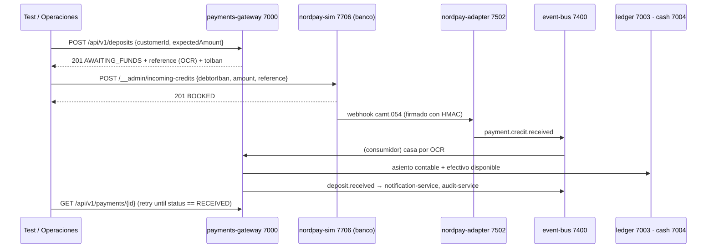

# F-01 · Ingreso de dinero

## Reglas

- La referencia OCR identifica al cliente: sin ella el abono queda **sin casar** y lo resuelve `reconciliation-service`.
- Importe distinto al esperado → se acepta el real y `amountMismatch: true`.
- El ingreso caduca a los 7 días (`expiresAt`).
- Para probar caídas del banco: `POST /__admin/behaviour` en nordpay-sim (`down`, `slow`, `failNext`).

## Dónde se prueba

`tests/Nordvik.ApiTests/PaymentsTests.cs`, el ayudante `Flows.Deposit` y en la academia `L18` y `_cliente-con-dinero.feature`.
