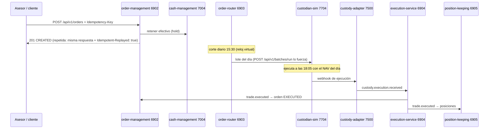

# F-02 · Orden de compra y ejecución

## Reglas de negocio (códigos que verás)

| Caso | Respuesta |
|---|---|
| Sin `Idempotency-Key` | 400 `IDEMPOTENCY_KEY_REQUIRED` |
| Misma clave, otro cuerpo | 422 `IDEMPOTENCY_KEY_REUSED` |
| Importe < mínimo del fondo | 422 `BELOW_MINIMUM` |
| Sin efectivo | 422 `INSUFFICIENT_FUNDS` (y se guarda: repetirla da el mismo error) |
| Fondo cerrado / ISIN desconocido | 422 `FUND_CLOSED` / `UNKNOWN_FUND` |
| Cartera ajena (cliente) | 404 `PORTFOLIO_NOT_FOUND` |
| Cartera de un cliente no asignado (asesor) | 403 `ACCESS_DENIED` |
| Cancelar una orden ya enviada | 409 `ORDER_NOT_CANCELLABLE` |

## Dónde se prueba

`TradingTests.cs` (con `Flows.ExecuteAt1805`) y la academia `L19`.
