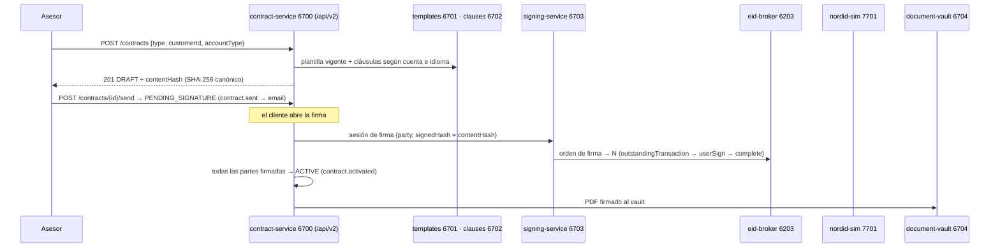

# F-03 · Contrato y firma electrónica

```
DRAFT ──send──▶ PENDING_SIGNATURE ──firma──▶ (PARTIALLY_SIGNED) ──▶ ACTIVE ──▶ WITHDRAWN · SUPERSEDED · TERMINATED
                         └──▶ EXPIRED · INVALID_SIGNATURE
```



## Reglas

- NordID admite **una firma en curso por persona**: otra sesión mientras la primera está PENDING → 409 `SIGNING_ALREADY_IN_PROGRESS`.
- Los anexos solo se añaden en DRAFT (después: 409).
- Si lo firmado no coincide con el contrato (otro `contentHash` u otra versión de plantilla), el contrato pasa a `INVALID_SIGNATURE` (test T26).
- Plazo para firmar: 14 días desde el envío; después, `EXPIRED`.
- Desistimiento: 14 días desde la activación (`withdrawalDeadline`).

## Dónde se prueba

`ContractTests.cs` (`ContractFlows`) y la academia `L20`.
