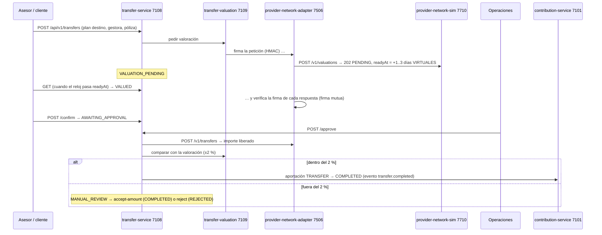

# F-07 · Traspaso entrante desde otra gestora (E10)

## Máquina de estados

`VALUATION_PENDING → VALUED → AWAITING_APPROVAL → COMPLETED | MANUAL_REVIEW → COMPLETED | REJECTED`;
cancelable por el cliente hasta la aprobación; `EXPIRED` si la valoración pasa de 30 días.

| Caso | Respuesta |
|---|---|
| Paso fuera de orden (confirmar sin valorar, cancelar tras completar…) | 409 `INVALID_STATE_TRANSITION` |
| Aprobar con la valoración caducada | 409 `VALUATION_EXPIRED` |
| Otra solicitud para la misma póliza en curso | 409 `TRANSFER_ALREADY_IN_PROGRESS` |
| Póliza o gestora desconocida | 404 `POLICY_NOT_FOUND` / `PROVIDER_NOT_FOUND` |
| La póliza es de otra persona | 422 `POLICY_HOLDER_MISMATCH` |
| La gestora firma mal su respuesta | 502 `INVALID_PROVIDER_SIGNATURE` |
| Aprobar sin ser Operaciones | 403 `ROLE_NOT_ALLOWED` |

`/__admin/policies` del simulador fija valor, días de demora y desviación; `/__admin/tamper` hace que firme mal.

## Dónde se prueba

`TransferTests` (PensionTests.cs) y `PensionMathTests` (tolerancia y estados).
