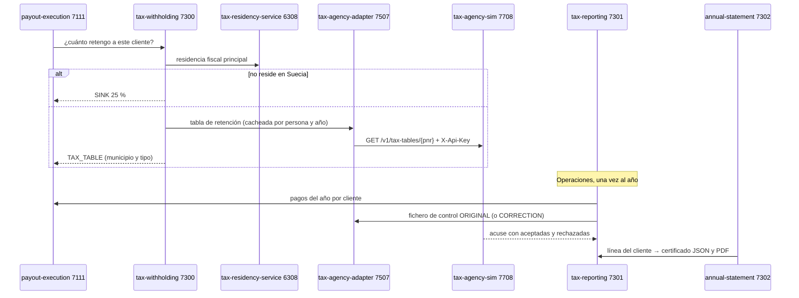

# F-10 · Retenciones, informe anual y certificados (E8)

| Caso | Respuesta |
|---|---|
| Rentas del capital (INTEREST, DIVIDEND, CAPITAL_GAIN) | 30 % plano (`CAPITAL_INCOME`) |
| Segundo ORIGINAL del mismo año | 409 `REPORT_ALREADY_FILED` (usa `CORRECTION`) |
| CORRECTION sin original | 409 `NOTHING_TO_CORRECT` |
| La Agencia rechaza el fichero entero (`/__admin/reject-next`) | 422 con su código (`SCHEMA_ERROR`) |
| Certificado de un año sin presentar | 404 `STATEMENT_NOT_AVAILABLE` |
| Extracto de un periodo que no ha empezado | 422 `PERIOD_NOT_STARTED` |
| Analítica con k < 5 | 400 `K_TOO_LOW`; los grupos pequeños salen `suppressed: true` con null |

## Dónde se prueba

`TaxTests` (InsuranceTaxTests.cs) y `PayoutTests`.
