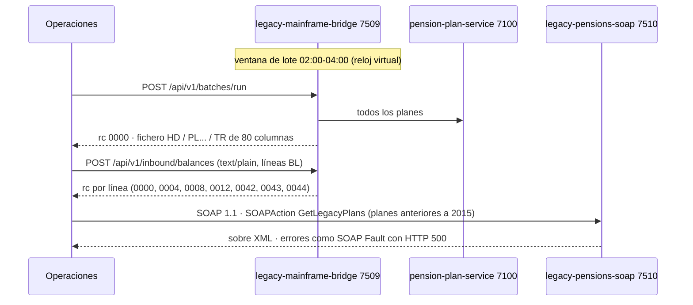

# F-12 · Sistemas heredados: mainframe de ancho fijo y pensiones SOAP

| Caso | Respuesta |
|---|---|
| Lanzar el lote fuera de la ventana | 409 con `rc: "0016"` |
| Línea de longitud distinta de 80 | rc `0008` |
| Fecha imposible / importe no numérico / plan desconocido | rc `0042` / `0043` / `0044` |
| Sin cabecera SOAPAction | 500 Fault `NO_SOAPACTION` |
| Número nacional no válido / plan que no es de esa persona | 500 Fault `INVALID_PNR` / `PLAN_NOT_FOUND` |
| XML mal formado | 500 Fault `MALFORMED_XML` |

`GET /api/v1/layouts` describe cada registro (posición y longitud) y `GET /soap/LegacyPensionService?wsdl` el contrato SOAP.

## Dónde se prueba

`LegacyAndQualityTests` (EnterpriseTests.cs).
