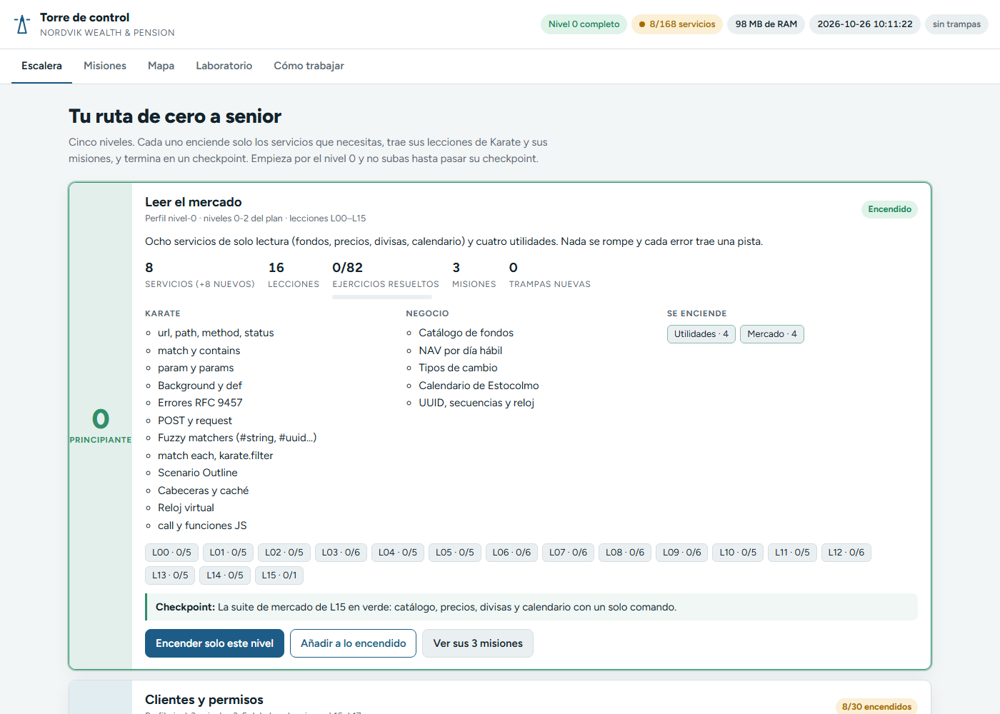
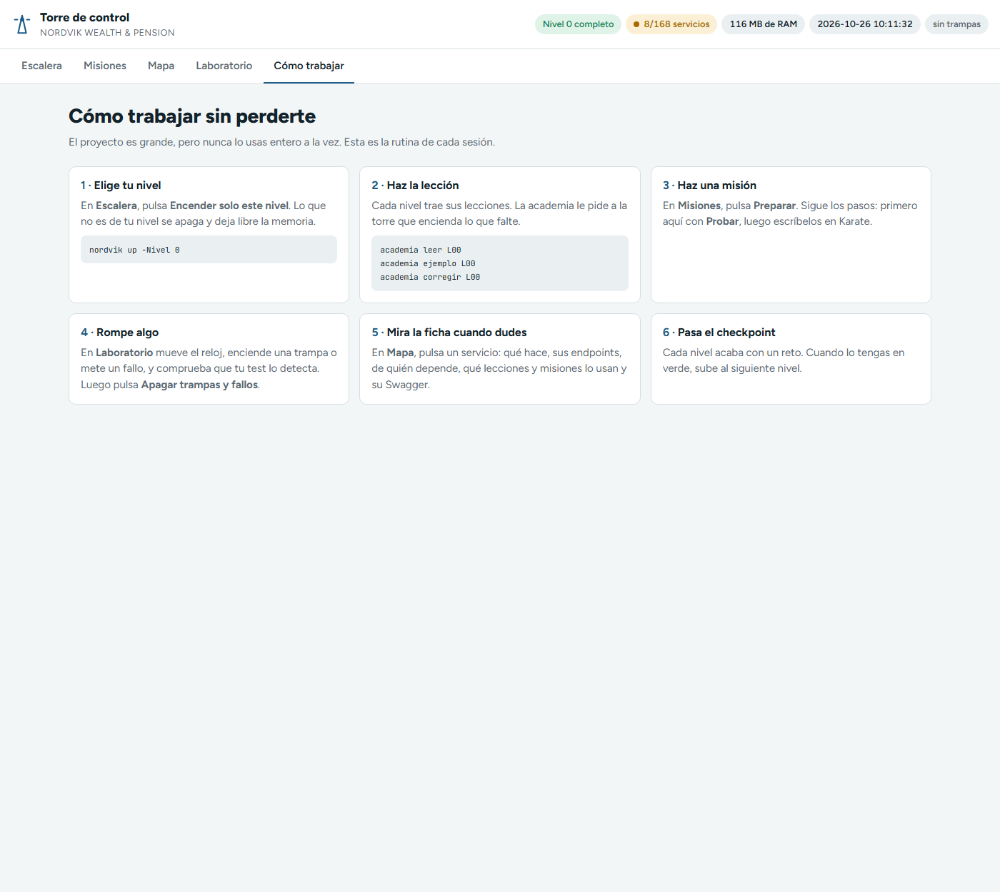

# 2 · La Torre de control

La Torre de control es una web que sirve el propio `Nordvik.Host` en `http://localhost:3000`. Desde ella eliges nivel, preparas misiones, enciendes y apagas servicios, lees la ficha de cada uno y provocas fallos.

## Paso 1 · Abre la torre

**Acción.** Con Nordvik en marcha, abre `http://localhost:3000` (o `.\nordvik.cmd torre`).

**Lo que ves.** La pestaña **Escalera**:



## Paso 2 · Lee la barra superior

Arriba a la derecha hay cinco indicadores. Se refrescan solos cada 5 segundos.

| Indicador | Ejemplo | Qué significa |
| --- | --- | --- |
| Nivel | `Nivel 0 completo` | El nivel más alto con **todos** sus servicios encendidos. |
| Servicios | `8/168 servicios` | Encendidos / total. Naranja mientras no estén todos. |
| RAM | `113 MB de RAM` | Memoria del proceso `Nordvik.Host`. |
| Reloj | `2026-10-26 09:46:51` | Hora del reloj virtual. Si está congelado, pone `· congelado`. |
| Trampas | `sin trampas` | Cuántas trampas activables están encendidas (rojo si hay alguna). |

## Paso 3 · Conoce las cinco pestañas

| Pestaña | Para qué | Capítulo |
| --- | --- | --- |
| **Escalera** | Ver los 5 niveles y encender uno | [3 · Niveles](03-niveles.md) |
| **Misiones** | Objetivos de negocio M01-M24 con sus pasos | [4 · Misiones](04-misiones.md) |
| **Mapa** | Los 168 servicios por dominio, interruptores y fichas | [5 · Mapa y fichas](05-mapa-y-fichas.md) |
| **Laboratorio** | Reloj virtual, fallos a propósito y 30 trampas | [6 · Laboratorio](06-laboratorio.md) |
| **Cómo trabajar** | La rutina de cada sesión, en 6 pasos | abajo |

## Paso 4 · Lee "Cómo trabajar"

**Acción.** Pulsa la pestaña **Cómo trabajar**.



**Qué significa.** Es la rutina de cada día:

1. **Elige tu nivel** en Escalera (o `nordvik up -Nivel 0`).
2. **Haz la lección**: `academia leer`, `academia ejemplo`, `academia corregir`.
3. **Haz una misión**: Preparar, probar los pasos y escribirlos en Karate.
4. **Rompe algo** en el Laboratorio y comprueba que tu test lo detecta.
5. **Mira la ficha** del servicio cuando dudes.
6. **Pasa el checkpoint** del nivel y sube al siguiente.

## Paso 5 · Usa los enlaces directos

Cada vista tiene su dirección. Puedes guardarlas en favoritos o compartirlas.

| Enlace | Abre |
| --- | --- |
| `http://localhost:3000/#escalera` | Escalera |
| `http://localhost:3000/#misiones` | Misiones |
| `http://localhost:3000/#mapa` | Mapa |
| `http://localhost:3000/#laboratorio` | Laboratorio |
| `http://localhost:3000/#guia` | Cómo trabajar |
| `http://localhost:3000/#ficha:product-catalog` | La ficha de un servicio (cambia el nombre) |
| `http://localhost:3000/#flujo:F-07-traspaso.md` | Un flujo de negocio de `docs/flows` |

## Paso 6 (opcional) · La API de la torre

Todo lo que hace la web lo hace con una API en `http://localhost:3000/api/v1`. Te sirve para automatizar (y para practicar Karate contra ella).

| Método y ruta | Qué hace |
| --- | --- |
| `GET /api/v1/estado` | Perfil, servicios encendidos, RAM, nivel actual, trampas encendidas |
| `GET /api/v1/niveles` · `GET /api/v1/niveles/{id}` | La escalera con el estado de cada nivel |
| `POST /api/v1/niveles/{id}/encender?modo=exacto` | Deja encendido solo ese nivel (`modo=sumar` lo añade) |
| `GET /api/v1/servicios` | Lista (filtros `nivel`, `dominio`, `q`, `encendidos`) |
| `GET /api/v1/servicios/{nombre}` | La ficha completa |
| `POST /api/v1/servicios/{nombre}/encender` · `/apagar?cascada=true` | Encender o apagar uno |
| `GET /api/v1/dominios` · `POST /api/v1/dominios/{código}/encender` · `/apagar` | Dominios enteros |
| `GET /api/v1/misiones` · `POST /api/v1/misiones/{id}/preparar` | Misiones |
| `GET /api/v1/lecciones` · `POST /api/v1/lecciones/{id}/preparar` | Lecciones y lo que necesitan |
| `GET /api/v1/trampas` | Las 30 trampas y su estado |
| `GET /api/v1/flujos/{fichero}` | El Markdown de un flujo |
| `ANY /api/v1/proxy/{servicio}/{ruta}` | Pasarela: llama a cualquier servicio encendido |

Ejemplo real (PowerShell):

```powershell
Invoke-RestMethod http://localhost:3000/api/v1/estado
```

```text
profile          : nivel-0
running          : 8
total            : 168
businessServices : 156
externals        : 12
memoryMb         : 97
privateMemoryMb  : 33
currentLevel     : 0
trapsOn          : 0
learningMode     : True
portOffset       : 0
services         : {calendar-service, clock-service, fx-rates, market-data...}
```

La tabla completa y la decisión de diseño están en `torre/README.md` y en [ADR-014](../adr/ADR-014-torre-de-control-y-escalera.md).

Los errores de la torre siguen el mismo formato RFC 9457 que los servicios, con `code` y `hint`. Por ejemplo, pedir el nivel 9 da `404 LEVEL_NOT_FOUND` con la pista "Los niveles van del 0 al 4."

Siguiente: [3 · Niveles](03-niveles.md)
