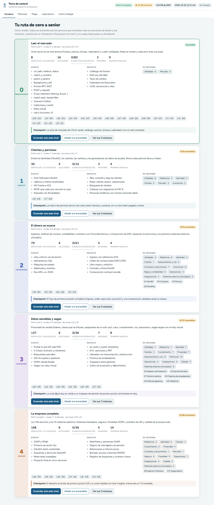

# 3 · Los niveles (la Escalera)

Nordvik se aprende por niveles. Cada nivel enciende solo los servicios que necesitas, trae sus lecciones y sus misiones, y termina en un **checkpoint**. No subas de nivel hasta pasar el checkpoint del tuyo.

## Los 5 niveles

| Nivel | Nombre | Tema | Perfil | Servicios | Lecciones | Misiones | Sistemas externos nuevos |
| --- | --- | --- | --- | --- | --- | --- | --- |
| 0 | Principiante | Leer el mercado | `nivel-0` | 8 | L00-L15 | M01-M03 | — |
| 1 | Básico | Clientes y permisos | `nivel-3` | 30 | L16-L17 | M04-M06 | — |
| 2 | Intermedio | El dinero se mueve | `nivel-6` | 79 | L18-L21 | M07-M11 | E1 NordID, E4 Custodio, E5 Precios, E6 NordPay |
| 3 | Avanzado | Datos sensibles y sagas | `nivel-9` | 137 | L22-L27 | M12-M18 | E2, E3, E7, E9, E10, E12 |
| 4 | Senior | La empresa completa | `completo` | 168 | L28-L33 | M19-M23 | E8 Agencia Tributaria, E11 Aseguradora |

**La regla.** Un servicio pertenece al nivel de su **oleada** (la tanda en que se construyó). El nivel N enciende todos los servicios con oleada menor o igual que N. Los perfiles `profiles/*.json` contienen exactamente esa lista.

**Los checkpoints** (de `torre/escalera.json`):

| Nivel | Checkpoint |
| --- | --- |
| 0 | La suite de mercado de L15 en verde: catálogo, precios, divisas y calendario con un solo comando. |
| 1 | La matriz de permisos de los tres roles sobre clientes y carteras, sin un solo token pegado a mano. |
| 2 | El flujo de primera inversión completo (ingreso, orden, ejecución, posición) y una composición validada campo a campo. |
| 3 | La suite @privacy en verde y un traspaso de pensión de punta a punta controlando el reloj. |
| 4 | El derecho al olvido de punta a punta (L33) y tu suite medida con test-insights: menos de un 1 % inestable. |

## Paso 1 · Lee la tarjeta de tu nivel

**Acción.** Abre `http://localhost:3000/#escalera`.



**Qué significa cada parte de una tarjeta:**

| Parte | Ejemplo (nivel 0) | Qué te dice |
| --- | --- | --- |
| Título y subtítulo | Leer el mercado · Perfil nivel-0 · lecciones L00–L15 | Tema, perfil y lecciones |
| Estado (arriba a la derecha) | `Encendido`, `8/30 encendidos` o `Apagado` | Cuántos servicios del nivel están en marcha |
| Servicios | `8 (+8 nuevos)` | Total del nivel y cuántos aparecen por primera vez |
| Ejercicios resueltos | `0/82` | Tu avance (lo lee de `academia/progreso.json`) |
| Misiones / Trampas nuevas | `3` / `0` | Lo que trae el nivel |
| Karate / Negocio | listas | Lo que aprendes de Karate y del negocio |
| Se enciende | `Utilidades · 4`, `Mercado · 4` | Dominios nuevos y cuántos servicios trae cada uno |
| Chips de lecciones | `L00 · 0/5` | Ejercicios resueltos por lección |
| Checkpoint | recuadro de color | El reto final del nivel |

## Paso 2 · Cambia de nivel en caliente

Hay dos botones por nivel:

| Botón | Qué hace | Equivale a |
| --- | --- | --- |
| **Encender solo este nivel** | Enciende lo que falta del nivel y **apaga** lo que sobra. Te pide confirmación. | `POST /api/v1/niveles/{id}/encender?modo=exacto` |
| **Añadir a lo encendido** | Enciende lo que falta sin apagar nada. | `POST /api/v1/niveles/{id}/encender?modo=sumar` |
| **Ver sus N misiones** | Abre Misiones filtradas por ese nivel. | — |

**Acción.** En la tarjeta del nivel 1 pulsa **Encender solo este nivel** y confirma.

**Lo que ves.** Un aviso "Preparando el nivel 1…" y, unos segundos después, "Nivel 1: 22 encendidos, 0 apagados · 30 en marcha". La barra superior pasa a `Nivel 1 completo` y `30/168 servicios`:


La respuesta real de la API al subir del nivel 0 al 1:

```json
{"level":1,"mode":"exacto","started":["address-service","allocation-engine","config-service","rate-limiter",
 "session-service","iam-service","api-gateway","benchmark-service","permission-service","customer-registry",
 "contact-service","customer-address-service","customer-search","data-reset-service","fee-engine",
 "synthetic-person-service","portfolio-service","fixture-loader","fund-factsheet","iban-service","isin-service",
 "preferences-service"],"stopped":[],"failed":{},"running":30}
```

**Qué significa.**

- No se ha reiniciado nada: el anfitrión arranca cada servicio nuevo dentro del mismo proceso.
- Cada servicio arranca **después de sus dependencias** (por eso `iam-service` va antes que `api-gateway`).
- Al bajar de nivel, los servicios se apagan pero **sus datos se conservan** (SQLite en `data\`).

Desde PowerShell, sin la web:

```powershell
Invoke-RestMethod -Method Post "http://localhost:3000/api/v1/niveles/1/encender?modo=exacto"
```

## Paso 3 · Arrancar directamente en un nivel

Si Nordvik está parado, arranca ya en el nivel que quieras:

```powershell
.\nordvik.cmd down
.\nordvik.cmd up -Nivel 2
```

`-Nivel 2` usa el perfil `nivel-6` (79 servicios). Un número fuera de 0-4 da el error `No existe el nivel 5. Los niveles van del 0 al 4: nordvik niveles`.

## Paso 4 · Memoria

Presupuesto de RAM de cada perfil (`nordvik profiles`, columna "RAM máx."): `nivel-0` 300 MB, `nivel-3` 450 MB, `nivel-6` 900 MB, `nivel-9` 1400 MB, `completo` 2000 MB. En las pruebas de esta guía el nivel 3 con 137 servicios ocupaba unos 300 MB.

## Paso 5 · El modo didáctico

Con el **modo didáctico** encendido, los errores de los servicios traen un campo `hint` con una pista (lo verás en el [capítulo 8](08-swagger-y-primeras-peticiones.md)). Todos los perfiles lo traen encendido (`"learningMode": true` en `profiles/*.json`).

- Para arrancar sin pistas: `.\nordvik.cmd up -NoLearning`.
- Para una sola petición: cabecera `X-Learning-Mode: false` (o `true`).

Siguiente: [4 · Misiones](04-misiones.md)
