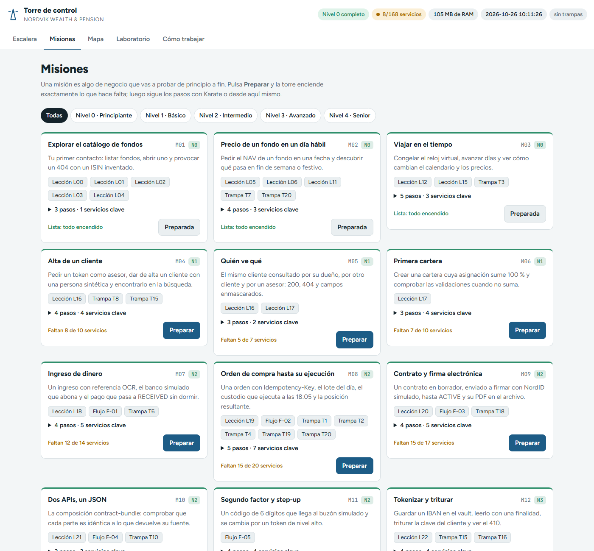

# 4 · Misiones

Una **misión** es algo de negocio que vas a probar de principio a fin: "dar de alta un cliente", "comprar un fondo hasta que se ejecute", "traspasar una pensión". Hay 23 (M01-M23), repartidas por niveles. Cada una dice qué servicios necesita, qué pasos seguir, qué lecciones la cubren, qué flujo de negocio la explica y qué trampas tiene.

## Paso 1 · Abre la pestaña Misiones

**Acción.** Abre `http://localhost:3000/#misiones`.



**Qué ves en cada tarjeta:**

| Parte | Ejemplo (M01) | Qué significa |
| --- | --- | --- |
| Título, id y nivel | Explorar el catálogo de fondos · `M01` `N0` | Nivel al que pertenece |
| Historia | "Tu primer contacto: listar fondos, abrir uno y provocar un 404..." | Qué vas a hacer |
| Chips | `Lección L00` ... `Flujo F-01` `Trampa T7` | Lecciones, flujo (botón: abre el flujo) y trampas relacionadas |
| Pasos | `▶ 3 pasos · 1 servicios clave` | Despliégalo para ver método, ruta, servicio y puerto de cada paso |
| Pie | `Lista: todo encendido` o `Faltan 8 de 10 servicios` | Si ya puedes hacerla con lo que tienes encendido |
| Botón | **Preparar** / **Preparada** | Enciende lo que falta |

Los filtros de arriba (**Todas**, **Nivel 0 · Principiante**...) muestran solo las de un nivel.

## Paso 2 · Prepara una misión

**Acción.** En una misión con "Faltan N servicios", pulsa **Preparar**.

**Qué pasa.** La torre enciende los servicios clave **y todas sus dependencias**, sin apagar nada. Sale un aviso como "M04: encendidos 8 servicios (...)". El pie cambia a "Lista: todo encendido".

Por API:

```powershell
Invoke-RestMethod -Method Post http://localhost:3000/api/v1/misiones/M01/preparar
```

Respuesta real con el nivel 0 encendido (no hacía falta nada):

```json
{"mission":"M01","started":[],"alreadyRunning":["clock-service","product-catalog"],"failed":{},"running":8,"ready":true}
```

## Paso 3 · Sigue los pasos

**Acción.** Pulsa `▶ 3 pasos` para desplegarlos. Los de M01 son:

| Método | Ruta | Servicio · puerto | Qué hacer |
| --- | --- | --- | --- |
| GET | `/api/v1/funds` | product-catalog · 6801 | Lista de fondos; prueba `?category=EQUITY` |
| GET | `/api/v1/funds/{isin}` | product-catalog · 6801 | Ficha de `SE0000000001` |
| GET | `/api/v1/funds/{isin}/fees` | product-catalog · 6801 | Comisiones del fondo |

Cada paso tiene un botón:

- **Probar** (solo en pasos `GET` sin `{variables}` en la ruta): la torre hace la llamada por su pasarela y te enseña el código y el JSON en una ventana.
- **Swagger** (el resto): abre `http://localhost:<puerto>/swagger` para que lo pruebes con **Try it out**.

Después escribe esos mismos pasos en Karate. Las lecciones que salen en la tarjeta te enseñan cómo.

## Paso 4 · Abre el flujo de la misión

Las misiones de los niveles 2 a 4 tienen un chip **Flujo F-0X**. Púlsalo y se abre el diagrama de secuencia del flujo con sus reglas. Más en el [capítulo 9](09-flujos-de-negocio.md).

## Todas las misiones

| Id | Nivel | Misión | Servicios clave | Lecciones | Flujo | Trampas |
| --- | --- | --- | --- | --- | --- | --- |
| M01 | 0 | Explorar el catálogo de fondos | `product-catalog` | L00, L01, L02, L03, L04 | — | — |
| M02 | 0 | Precio de un fondo en un día hábil | `market-data`, `calendar-service`, `fx-rates` | L05, L06, L11 | — | T7, T20 |
| M03 | 0 | Viajar en el tiempo | `clock-service`, `calendar-service`, `market-data` | L12, L15 | — | T3 |
| M04 | 1 | Alta de un cliente | `iam-service`, `synthetic-person-service`, `customer-registry`, `customer-search` | L16 | — | T8, T15 |
| M05 | 1 | Quién ve qué | `iam-service`, `customer-registry` | L16, L17 | — | — |
| M06 | 1 | Primera cartera | `iam-service`, `customer-registry`, `portfolio-service`, `allocation-engine` | L17 | — | — |
| M07 | 2 | Ingreso de dinero | `payments-gateway`, `nordpay-sim`, `nordpay-adapter`, `cash-management`, `ledger-service` | L18 | F-01-ingreso | T6 |
| M08 | 2 | Orden de compra hasta su ejecución | `order-management`, `order-router`, `custody-adapter`, `custodian-sim`, `execution-service`, `position-keeping`, `valuation-service` | L19 | F-02-orden | T1, T2, T4, T19, T20 |
| M09 | 2 | Contrato y firma electrónica | `contract-service`, `signing-service`, `eid-broker`, `nordid-sim`, `document-vault` | L20 | F-03-contrato | T18 |
| M10 | 2 | Dos APIs, un JSON | `composition-service`, `contract-service`, `document-vault` | L21 | F-04-composicion | T10 |
| M11 | 2 | Segundo factor y step-up | `mfa-service`, `step-up-service`, `notification-service`, `payments-gateway` | — | F-05-mfa-step-up | — |
| M12 | 3 | Tokenizar y triturar | `pii-vault`, `key-management`, `consent-ledger`, `data-passport` | L22 | — | T15, T16 |
| M13 | 3 | Caos y resiliencia | `chaos-control`, `mock-control`, `sanctions-adapter` | L23 | — | — |
| M14 | 3 | KYC y sanciones | `kyc-aml-service`, `sanctions-adapter`, `sanctionscreen-sim`, `pep-service`, `risk-scoring` | L24 | — | — |
| M15 | 3 | Una llamada de voz | `voice-service`, `transcription-service`, `insight-extraction`, `call-summary`, `telephony-sim`, `consent-ledger` | L25 | — | — |
| M16 | 3 | Fichero mensual de un empleador | `employer-portal-api`, `employer-clearing-sim`, `employer-clearing-adapter`, `employer-file-ingest`, `contribution-service`, `pension-plan-service` | L26 | F-06-fichero-empleador | — |
| M17 | 3 | Traspaso de una pensión | `transfer-service`, `transfer-valuation`, `provider-network-adapter`, `provider-network-sim`, `pension-plan-service`, `contribution-service` | L27 | F-07-traspaso | T27 |
| M18 | 3 | Cobro de la pensión y fallecimiento | `payout-planner`, `payout-execution`, `annuity-calculator`, `death-claims`, `beneficiary-service`, `pension-plan-service` | — | F-08-cobro-y-fallecimiento | T24 |
| M19 | 4 | Seguro ligado a la pensión | `health-declaration`, `insurance-policy`, `premium-calculator`, `insurance-claims`, `insurer-adapter`, `insurer-sim` | L30 | F-09-seguro-ligado-a-la-pension | T23 |
| M20 | 4 | Fiscalidad del año | `tax-withholding`, `tax-reporting`, `annual-statement`, `tax-agency-adapter`, `tax-agency-sim`, `tax-residency-service`, `payout-execution` | — | F-10-fiscalidad | T24, T25 |
| M21 | 4 | Derecho al olvido | `erasure-orchestrator`, `dsar-service`, `breach-service`, `pii-vault`, `key-management`, `consent-ledger`, `customer-registry` | L33 | F-11-derechos-rgpd | T28 |
| M22 | 4 | Sistemas heredados | `legacy-mainframe-bridge`, `legacy-pensions-soap`, `pension-plan-service` | L28, L29 | F-12-sistemas-heredados | T21, T22 |
| M23 | 4 | Contratos de API y tests inestables | `schema-registry`, `contract-check`, `test-insights`, `product-catalog` | L31, L32 | — | T9, T26, T29, T30 |

> Algunas misiones citan trampas de un nivel superior (por ejemplo M02 cita T7 y T20, que son del nivel 4). Al hacer la misión en su nivel, esas trampas aún no se pueden encender: léelas como aviso de lo que vendrá. Las trampas activables se encienden con `chaos-control`, que llega en el nivel 3.

Siguiente: [5 · Mapa y fichas](05-mapa-y-fichas.md)
