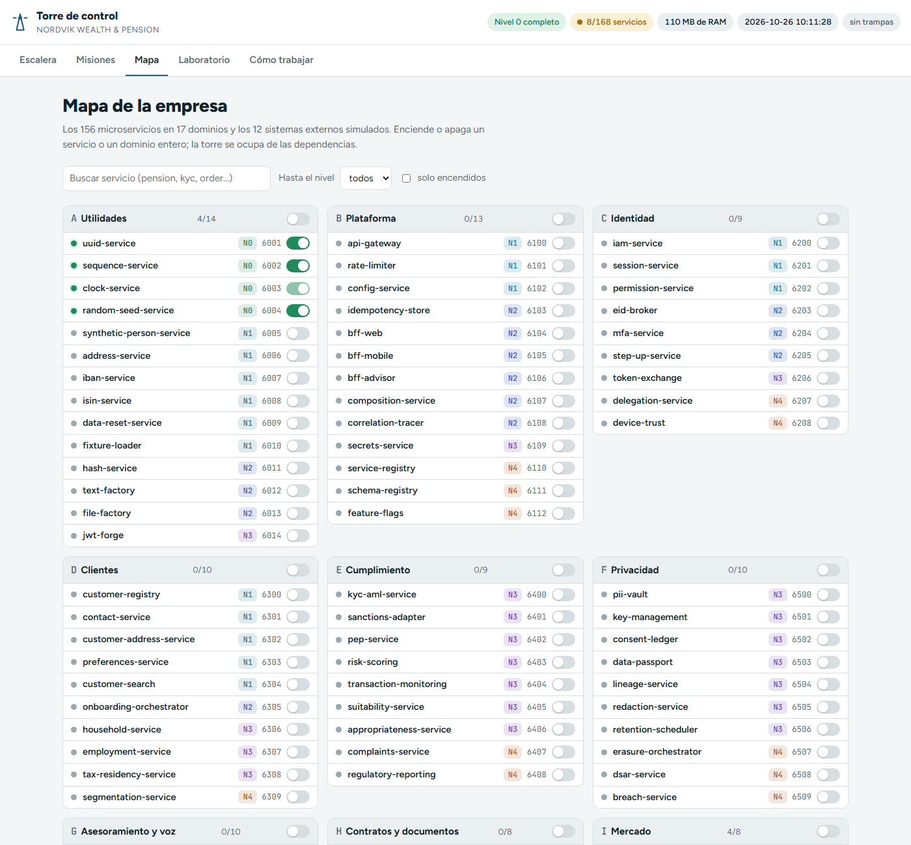
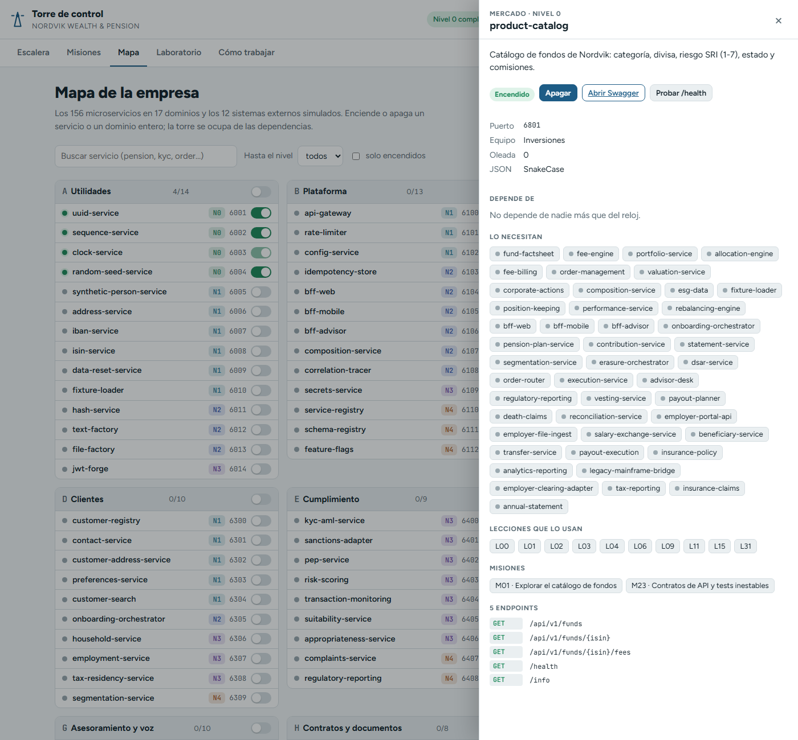
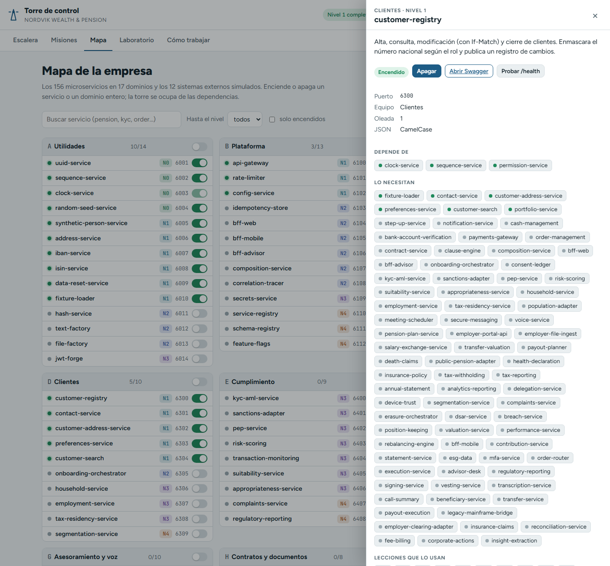
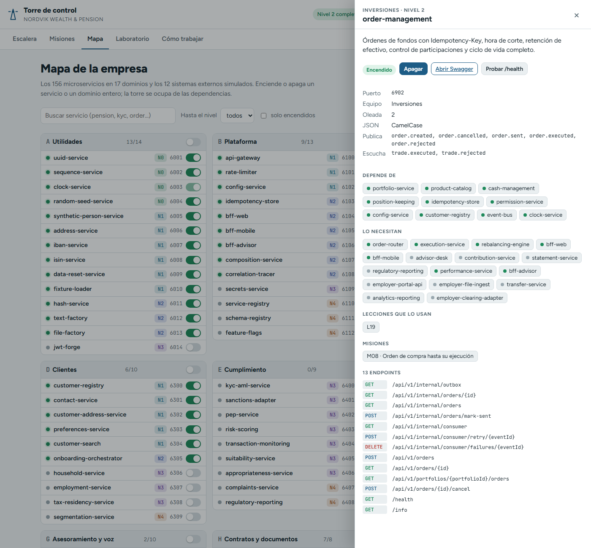
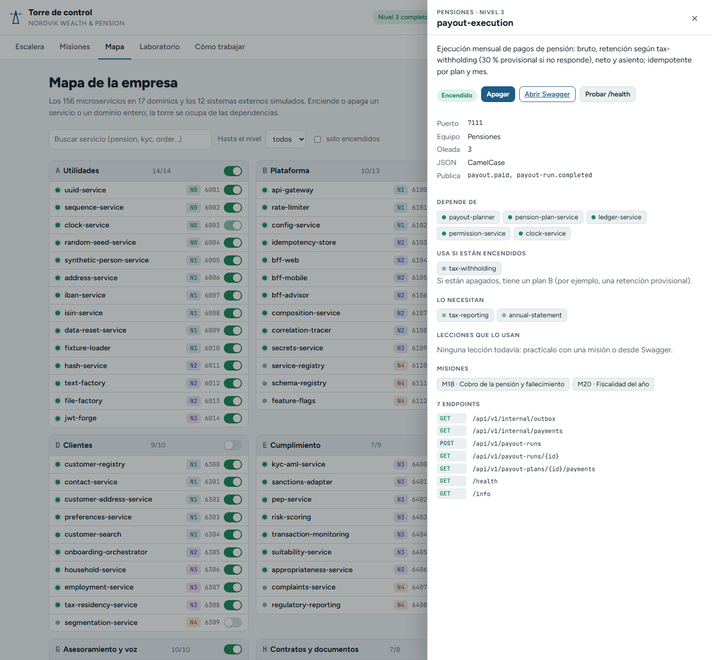

# 5 · El Mapa y las fichas de servicio

El **Mapa** muestra los 168 servicios agrupados en 18 bloques: los 17 dominios de negocio y los sistemas externos simulados. Desde aquí enciendes y apagas servicios o dominios enteros, y abres la **ficha** de cualquier servicio.

## Paso 1 · Abre el Mapa

**Acción.** Abre `http://localhost:3000/#mapa`.



**Qué ves en cada fila:**

| Elemento | Ejemplo | Qué significa |
| --- | --- | --- |
| Punto | verde / gris | Encendido / apagado |
| Nombre | `product-catalog` | Púlsalo para abrir la ficha |
| Insignia | `N0` | Nivel al que pertenece |
| Número | `6801` | Puerto |
| Interruptor | on / off | Enciende o apaga ese servicio |

En la cabecera de cada dominio: la letra (A-Q, X), el nombre, `encendidos/total` y un interruptor para el dominio entero.

**Herramientas de arriba:**

- **Buscar servicio**: filtra por nombre o descripción (`pension`, `kyc`, `order`...).
- **Hasta el nivel**: atenúa los servicios de niveles superiores.
- **solo encendidos**: oculta los apagados.

## Los dominios

| Código | Dominio | Servicios | Niveles |
| --- | --- | --- | --- |
| A-utilities | Utilidades | 14 | 0-3 |
| B-platform | Plataforma | 13 | 1-4 |
| C-identity | Identidad | 9 | 1-4 |
| D-customer | Clientes | 10 | 1-4 |
| E-compliance | Cumplimiento | 9 | 3-4 |
| F-privacy | Privacidad | 10 | 3-4 |
| G-advice | Asesoramiento y voz | 10 | 2-3 |
| H-contracts | Contratos y documentos | 8 | 2, 4 |
| I-market | Mercado | 8 | 0, 1, 4 |
| J-investment | Inversiones | 10 | 1-2 |
| K-payments | Pagos y contabilidad | 9 | 2 |
| L-pensions | Pensiones | 14 | 3 |
| M-insurance | Seguros | 4 | 4 |
| N-tax | Fiscalidad | 5 | 4 |
| O-operations | Operaciones | 7 | 2-4 |
| P-integrations | Integraciones | 11 | 2-4 |
| Q-quality | Calidad | 5 | 3-4 |
| X-external | Sistemas externos (simulados) | 12 | 2-4 |

(Salida de `GET /api/v1/dominios`. Los puertos siguen el dominio: A = 6001-6014, B = 6100-6112, C = 6200..., X = 7701-7712.)

## Paso 2 · Enciende un servicio suelto

**Acción.** Con el nivel 0 encendido, activa el interruptor de `customer-registry` (dominio Clientes).

**Qué pasa.** La torre enciende `customer-registry` **y sus dependencias** (`sequence-service`, `permission-service`...). El aviso dice "Encendidos: ..." con la lista.

Por API: `POST http://localhost:3000/api/v1/servicios/customer-registry/encender` (con `?dependencias=false` no trae las dependencias).

## Paso 3 · Intenta apagar un servicio que otros necesitan

**Acción.** Con el nivel 1 encendido, apaga `product-catalog`.

**Lo que ves.** Una ventana "Otros servicios necesitan product-catalog" con la lista de dependientes, y dos botones: **Dejarlo encendido** o **Apagar los N**.

**Qué significa.** La torre no te deja romper la empresa sin avisar. La respuesta real de la API:

```json
{"type":"https://errors.nordvik.local/has-running-dependents","title":"Conflicto","status":409,
 "detail":"5 servicios encendidos dependen de product-catalog.",
 "instance":"/api/v1/servicios/product-catalog/apagar","code":"HAS_RUNNING_DEPENDENTS",
 "service":"torre-de-control","hint":"Apágalos también con ?cascada=true, o deja este encendido.",
 "dependents":["allocation-engine","fee-engine","fixture-loader","fund-factsheet","portfolio-service"]}
```

`clock-service` no se puede apagar nunca: responde `409 CORE_SERVICE` ("Todos los servicios le preguntan la hora al reloj virtual; sin él no funciona nada.").

## Paso 4 · Abre la ficha de un servicio

**Acción.** Pulsa el nombre `product-catalog`, o abre directamente `http://localhost:3000/#ficha:product-catalog`.



**Qué tiene la ficha:**

| Sección | Qué te dice |
| --- | --- |
| Cabecera | Dominio, nivel y nombre |
| Descripción | Qué hace el servicio |
| Botones | **Encender/Apagar**, **Abrir Swagger**, **Probar /health** |
| Puerto, Equipo, Oleada, JSON | `JSON` es el estilo de nombres de campos: `SnakeCase` (`base_currency`) o `CamelCase` (`baseCurrency`). Importa al escribir tus `match`. |
| Publica / Escucha | Eventos que emite y consume (si tiene) |
| Depende de | Servicios que necesita (punto verde = encendido). Púlsalos para saltar a su ficha. |
| Usa si están encendidos | Dependencias opcionales con plan B (si las hay) |
| Lo necesitan | Quién depende de este servicio |
| Lecciones que lo usan | Lecciones de la academia que le hacen peticiones |
| Misiones | Misiones donde aparece |
| Endpoints | Método, ruta y resumen, sacados de `docs/openapi/<servicio>.json` (sin los de `/_test`) |

Un servicio con dependencias, `customer-registry` (nivel 1):



Y uno del nivel 2, `order-management`:



Y uno del nivel 3 con una **dependencia opcional**, `payout-execution` (`#ficha:payout-execution`):



**Qué significa "Usa si están encendidos".** `payout-execution` paga las pensiones y pide el tipo de retención a `tax-withholding`, que es del nivel 4. En el nivel 3 ese servicio está apagado (punto gris), y `payout-execution` usa su plan B: una retención provisional del 30 %. Las dependencias opcionales no se encienden solas. Otro ejemplo: `#ficha:death-claims`.

Cierra la ficha con la **×**, con la tecla **Esc** o pulsando fuera.

## Dónde está la ficha escrita

Cada servicio tiene también su ficha en Markdown en `docs/services/<servicio>.md`, y su contrato en `docs/openapi/<servicio>.json`. El índice de todos está en `docs/README.md`.

Siguiente: [6 · Laboratorio](06-laboratorio.md)
