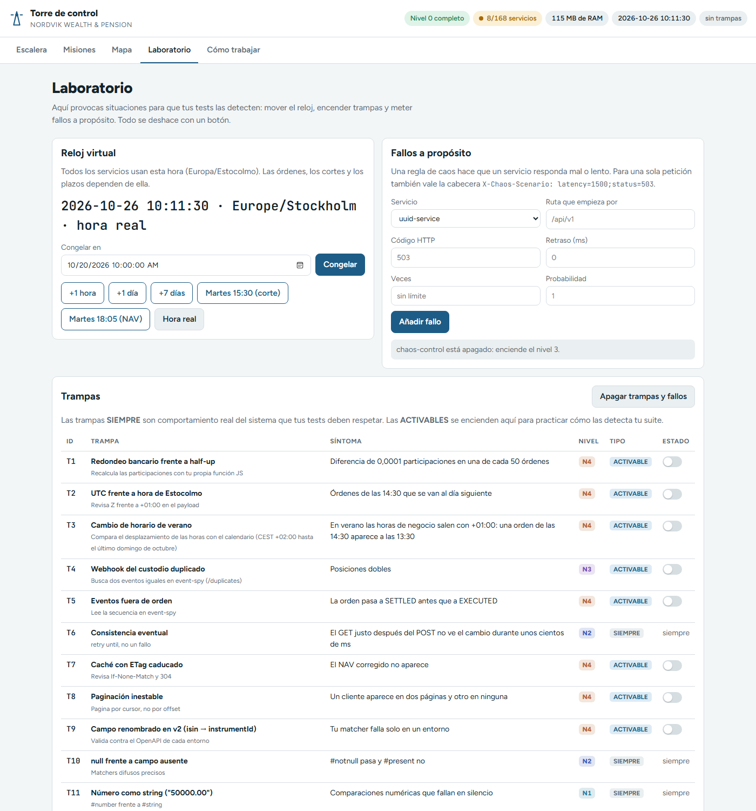
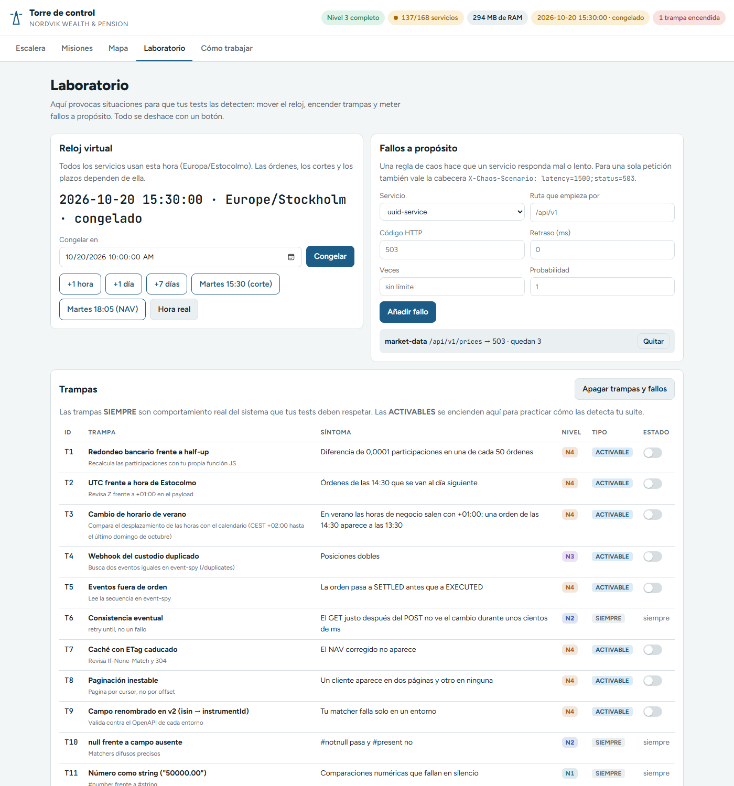

# 6 · El Laboratorio

En el Laboratorio provocas situaciones para que tus tests las detecten: mover el reloj, meter fallos a propósito y encender trampas. Todo se deshace con un botón.

## Paso 1 · Abre el Laboratorio

**Acción.** Abre `http://localhost:3000/#laboratorio`.



Tiene tres paneles: **Reloj virtual**, **Fallos a propósito** y **Trampas**.

Con el nivel 0, el panel de fallos dice "chaos-control está apagado: enciende el nivel 3." El reloj sí funciona desde el principio.

## Paso 2 · Controla el reloj virtual

Todos los servicios piden la hora a `clock-service` (6003), en la zona `Europe/Stockholm`. Las horas de corte de las órdenes, los plazos y los precios dependen de ella.

**Acciones en el panel:**

| Botón | Qué hace | API de clock-service |
| --- | --- | --- |
| **Congelar** (con fecha y hora) | Para el reloj en ese instante | `POST /api/v1/clock/freeze` `{"at":"2026-10-20T10:00:00"}` |
| **+1 hora**, **+1 día**, **+7 días** | Avanza el reloj | `POST /api/v1/clock/advance` `{"hours":1}` / `{"days":1}` |
| **Martes 15:30 (corte)** | Congela en 2026-10-20 15:30, justo después del corte de órdenes de las 15:00 | `freeze` |
| **Martes 18:05 (NAV)** | Congela en 2026-10-20 18:05, cuando el custodio ejecuta al NAV del día | `freeze` |
| **Hora real** | Vuelve a la hora del PC | `POST /api/v1/clock/reset` |

Respuestas reales de `clock-service`:

```text
GET  /api/v1/clock/now
{"now":"2026-10-26T09:57:39.929+01:00",...,"timezone":"Europe/Stockholm","date":"2026-10-26","time":"09:57:39","mode":"REAL","offsetSeconds":0}

POST /api/v1/clock/freeze {"at":"2026-10-20T15:30:00"}
{"now":"2026-10-20T15:30:00.000+02:00",...,"mode":"FROZEN","offsetSeconds":-502059}

POST /api/v1/clock/advance {"days":1}
{"now":"2026-10-21T15:30:00.000+02:00",...,"mode":"FROZEN","offsetSeconds":-415659}

POST /api/v1/clock/reset
{"now":"2026-10-26T09:57:40.016+01:00",...,"mode":"REAL","offsetSeconds":0}
```

**Qué significa.** `mode` puede ser `REAL`, `FROZEN` (congelado) u otro valor cuando el reloj está desplazado. Fíjate en el desfase: `+02:00` el 20 de octubre (horario de verano) y `+01:00` el 26 (horario de invierno). La barra superior de la torre se pone naranja mientras el reloj no está en hora real.

> **Acuérdate de pulsar Hora real** al terminar. Un reloj congelado olvidado hace fallar tests que no tienen nada que ver.

## Paso 3 · Mete un fallo a propósito (nivel 3)

Necesita `chaos-control` (7600), que llega en el nivel 3.

**Acción.** Rellena el formulario **Fallos a propósito**:

| Campo | Ejemplo | Qué significa |
| --- | --- | --- |
| Servicio | `market-data` | A quién afecta |
| Ruta que empieza por | `/api/v1/prices` | Solo esas rutas (vacío = todas) |
| Código HTTP | `503` | Código que devolverá (si lo dejas vacío y sin retraso, 503) |
| Retraso (ms) | `1500` | Latencia añadida |
| Veces | `3` | Cuántas peticiones fallan (vacío = sin límite) |
| Probabilidad | `0.5` | Fallo aleatorio (1 = siempre) |

Pulsa **Añadir fallo**. El fallo aparece en la lista con un botón **Quitar**.

**Sin chaos-control** (cualquier nivel) puedes fallar una sola petición con una cabecera:

```text
X-Chaos-Scenario: latency=1500;status=503
```

Respuesta real de `GET http://localhost:6801/api/v1/funds` con esa cabecera (tardó 1526 ms):

```json
{"type":"https://errors.nordvik.local/chaos-injected","title":"Fallo inyectado","status":503,
 "detail":"Fallo provocado a propósito en product-catalog (header).","instance":"/api/v1/funds",
 "code":"CHAOS_INJECTED","service":"product-catalog",
 "hint":"Lo ha puesto chaos-control (puerto 7600) o tu cabecera X-Chaos-Scenario. Quítalo con DELETE /api/v1/faults en chaos-control."}
```

## Paso 4 · Enciende una trampa (nivel 3)

Hay 30 trampas (T1-T30). La tabla dice el id, el nombre, cómo encontrarla, el síntoma, el nivel y el tipo:

- **SIEMPRE** (19): comportamiento real del sistema que tus tests deben respetar. No se apagan. Ejemplos: T6 consistencia eventual, T10 `null` frente a campo ausente, T17 hora de corte con segundos.
- **ACTIVABLE** (11: T1-T5, T7-T9, T15, T19, T20): se encienden con su interruptor para practicar cómo las detecta tu suite.

**Acción.** Con el nivel 3 encendido, activa el interruptor de **T15** ("PII que se filtra en un mensaje de error").

**Lo que ves.** La barra superior muestra `1 trampa encendida` en rojo. Así queda el Laboratorio con el reloj congelado, un fallo y una trampa:



Por API (a través de la pasarela de la torre o directamente en el puerto 7600):

```powershell
Invoke-RestMethod -Method Put http://localhost:7600/api/v1/traps/T15 -ContentType 'application/json' -Body '{"enabled":true}'
```

> Las trampas activables viven en memoria: al reiniciar Nordvik vuelven a estar apagadas.

## Paso 5 · Deja todo limpio

**Acción.** Pulsa **Apagar trampas y fallos** y después **Hora real**.

**Qué significa.** `POST /api/v1/reset` en chaos-control apaga todas las trampas activables y borra todos los fallos. El reloj se resetea aparte.

Siguiente: [7 · La academia](07-academia.md)
