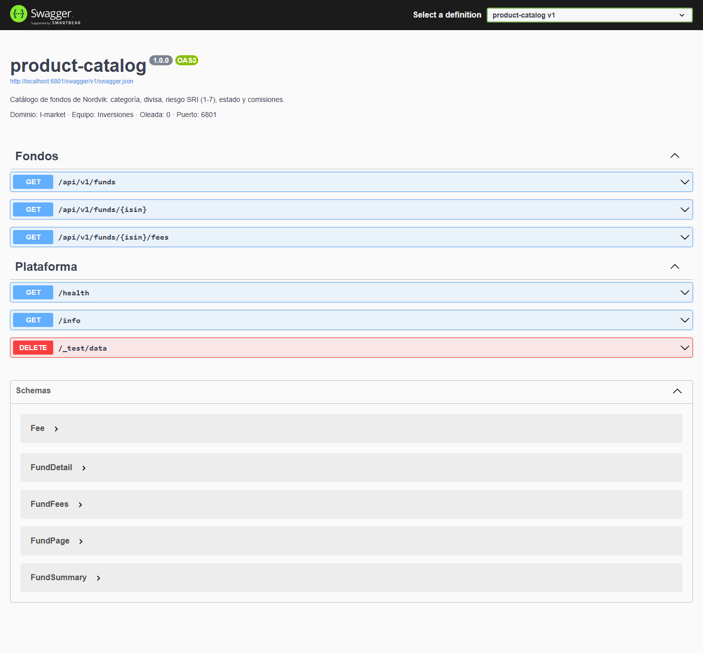
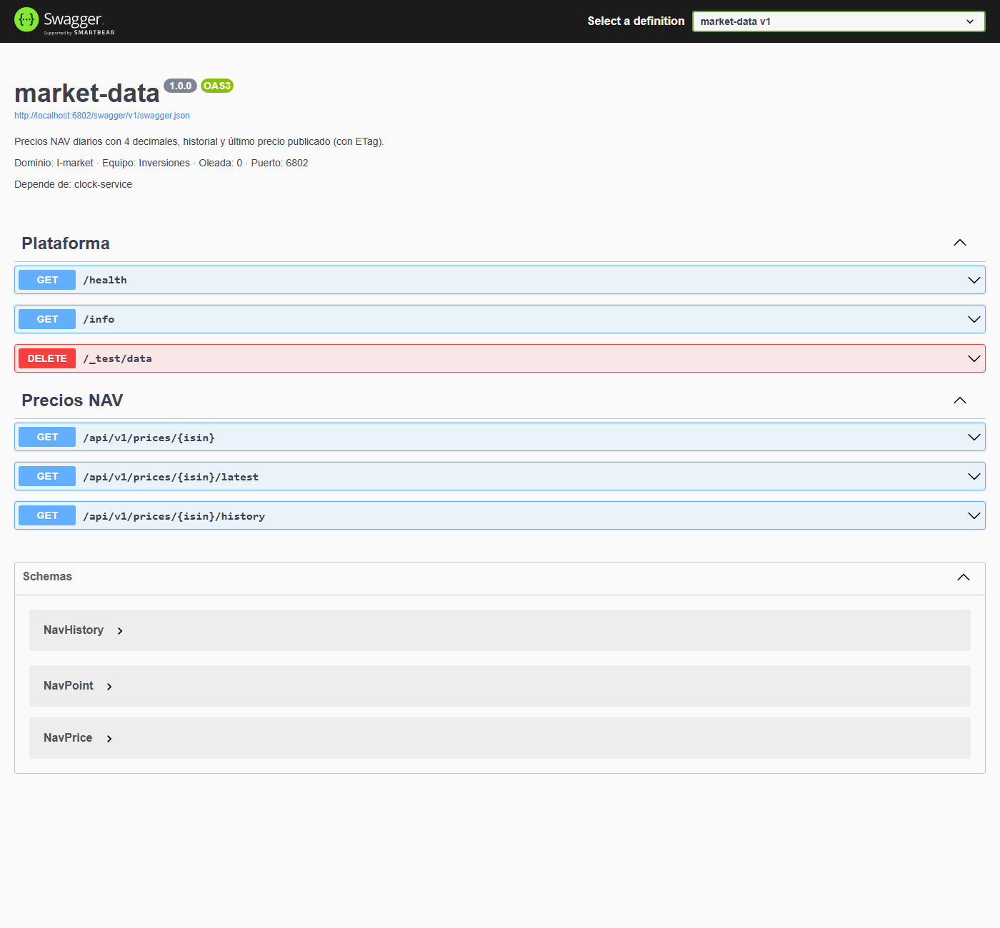
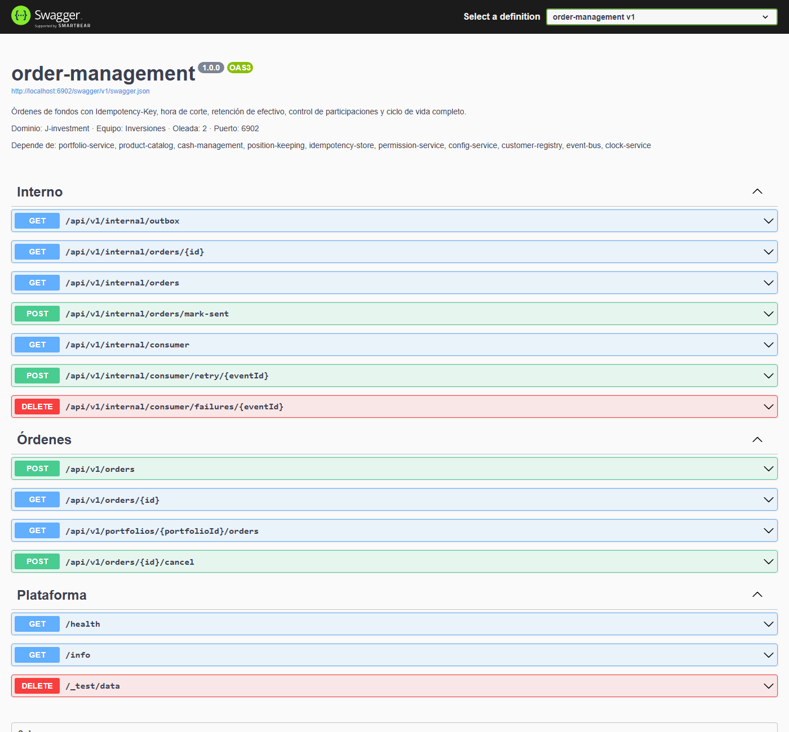

# 8 · Swagger y tus primeras peticiones

Antes de escribir Karate conviene "tocar" la API a mano: ver qué endpoints hay, qué pide cada uno y qué devuelve. Para eso cada servicio publica su **Swagger**.

## Paso 1 · Abre el Swagger de un servicio

**Acción.** Abre `http://localhost:6801/swagger` (product-catalog). También llegas desde la ficha del servicio (**Abrir Swagger**) o desde un paso de misión.



**Qué ves.**

- Arriba: nombre, versión (`1.0.0`), la URL del contrato (`/swagger/v1/swagger.json`) una línea con **dominio, equipo, oleada y puerto** y, si el servicio depende de otros, otra línea **Depende de:**.
- Los endpoints agrupados: **Fondos** (`GET /api/v1/funds`, `GET /api/v1/funds/{isin}`, `GET /api/v1/funds/{isin}/fees`) y **Plataforma** (`/health`, `/info` y `DELETE /_test/data`).
- **Schemas**: la forma de cada JSON (`FundSummary`, `FundDetail`, `FundPage`...).

`DELETE /_test/data` existe en todos los servicios para que las pruebas limpien sus datos. No lo uses en tus ejercicios.

Otro ejemplo del nivel 0, market-data (`http://localhost:6802/swagger`):



Y uno del nivel 2, order-management (`http://localhost:6902/swagger`), con muchos más endpoints:



## Paso 2 · Prueba un endpoint con "Try it out"

**Acción.**

1. Despliega `GET /api/v1/funds`.
2. Pulsa **Try it out**.
3. Escribe `EQUITY` en el parámetro `category`.
4. Pulsa **Execute**.

**Lo que ves.** Debajo aparecen el comando `curl` equivalente, la URL, el **código** (`200`), las **cabeceras** y el **cuerpo** JSON.

## Paso 3 · Haz la misma petición desde la terminal

En PowerShell, `curl` es un alias de otro comando. Usa siempre **`curl.exe`**.

```powershell
curl.exe -i "http://localhost:6801/api/v1/funds?category=EQUITY"
```

Respuesta real (recortada):

```text
HTTP/1.1 200 OK
Content-Type: application/json; charset=utf-8
X-Correlation-Id: corr-d874d51e71d047c9
X-Service: product-catalog
X-Service-Version: 1.0.0

{"items":[{"isin":"SE0000000004","name":"Nordvik Emerging Markets","category":"EQUITY","base_currency":"USD",
"sri":6,"status":"OPEN","management_fee":"1.10"}, ... ],"page":1,"page_size":20,"total":7,"total_pages":1}
```

**Qué significa.**

| Parte | Significado |
| --- | --- |
| `200 OK` | Éxito |
| `X-Correlation-Id` | Identificador de esta petición. Si mandas tú uno, se respeta; si no, el servicio crea uno. Sirve para seguir una llamada por varios servicios (`nordvik trace <id>`, nivel 2). |
| `X-Service`, `X-Service-Version` | Quién te ha contestado |
| `items`, `page`, `page_size`, `total`, `total_pages` | Una lista paginada. Hay 7 fondos `EQUITY`. |
| `base_currency`, `management_fee` | product-catalog usa `snake_case`. Ojo: `management_fee` es un **texto** (`"1.10"`), no un número (trampa T11). |

Un fondo concreto:

```powershell
curl.exe http://localhost:6801/api/v1/funds/SE0000000001
```

```json
{"isin":"SE0000000001","name":"Nordvik Global Equity","category":"EQUITY","base_currency":"SEK","sri":4,"status":"OPEN",
 "launch_date":"2012-03-01","manager":"Equipo Renta Variable Global",
 "fees":[{"type":"MANAGEMENT","percent":"0.45"},{"type":"ENTRY","percent":"0.00"},{"type":"EXIT","percent":"0.00"}],
 "description":"Nordvik Global Equity es un fondo de categoría EQUITY en SEK con riesgo SRI 4 sobre 7."}
```

## Paso 4 · Provoca errores y léelos

Los errores de Nordvik siguen el estándar **RFC 9457** (`application/problem+json`) y añaden `code`, `correlationId`, `service` y, en modo didáctico, `hint`.

**Un fondo que no existe** → `404`:

```powershell
curl.exe -i http://localhost:6801/api/v1/funds/SE9999999999
```

```text
HTTP/1.1 404 Not Found
Content-Type: application/problem+json; charset=utf-8

{"type":"https://errors.nordvik.local/fund-not-found","title":"No encontrado","status":404,
 "detail":"No existe ningún fondo con ISIN SE9999999999.","instance":"/api/v1/funds/SE9999999999",
 "code":"FUND_NOT_FOUND","correlationId":"corr-6b9ca0479e264f72","service":"product-catalog",
 "hint":"El formato es correcto pero el fondo no está en el catálogo. Lista los existentes con GET /api/v1/funds."}
```

**Un ISIN mal formado** → `400`:

```powershell
curl.exe http://localhost:6801/api/v1/funds/HOLA
```

```json
{"type":"https://errors.nordvik.local/invalid-isin","title":"Petición no válida","status":400,
 "detail":"'HOLA' no tiene formato de ISIN.","instance":"/api/v1/funds/HOLA","code":"INVALID_ISIN",
 "correlationId":"corr-cb0ff51881134d17","service":"product-catalog",
 "hint":"Un ISIN tiene 12 caracteres: 2 letras de país, 9 alfanuméricos y 1 dígito de control. Ejemplo: SE0000000001. ¿Está en minúsculas?"}
```

**Qué significa.** `404` = el formato es bueno pero el recurso no existe. `400` = lo que pides no tiene sentido. En tus tests compara siempre `status` **y** `code`: el `code` es estable, el texto de `detail` puede cambiar.

## Paso 5 · Comprueba la salud de un servicio

```powershell
curl.exe http://localhost:6801/health
```

```json
{"status":"UP","service":"product-catalog","version":"1.0.0","uptimeSeconds":0}
```

`nordvik status` hace esta misma llamada a cada servicio.

## Paso 6 · Pásalo a Karate

La petición del paso 3, en Karate (es el ejemplo de L00):

```gherkin
Scenario: Pedir el catálogo de fondos
  Given url catalogUrl
  And path '/api/v1/funds'
  When method get
  Then status 200
  And print 'El catálogo tiene', response.total, 'fondos'
```

## Puertos de los servicios del nivel 0

| Servicio | Puerto | Swagger |
| --- | --- | --- |
| uuid-service | 6001 | `http://localhost:6001/swagger` |
| sequence-service | 6002 | `http://localhost:6002/swagger` |
| clock-service | 6003 | `http://localhost:6003/swagger` |
| random-seed-service | 6004 | `http://localhost:6004/swagger` |
| product-catalog | 6801 | `http://localhost:6801/swagger` |
| market-data | 6802 | `http://localhost:6802/swagger` |
| fx-rates | 6803 | `http://localhost:6803/swagger` |
| calendar-service | 6804 | `http://localhost:6804/swagger` |

La lista completa de los 168 servicios con su puerto está en `docs/README.md`.

Siguiente: [9 · Flujos de negocio](09-flujos-de-negocio.md)
