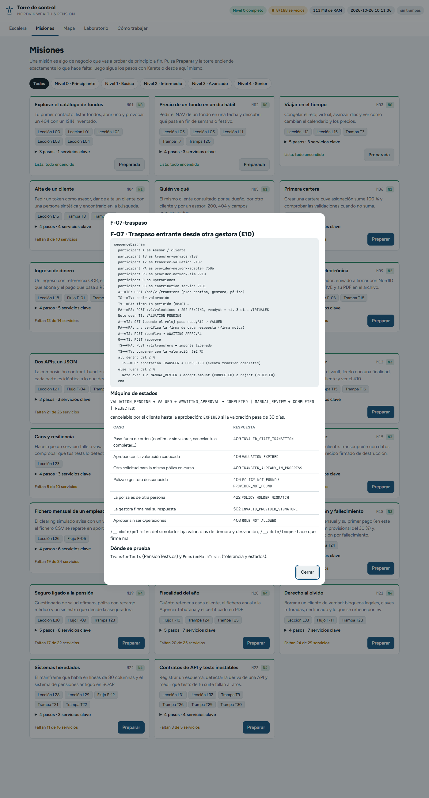

# 9 · Los flujos de negocio

Un **flujo** explica una operación de negocio que cruza varios servicios: quién llama a quién, qué evento sale, qué estados recorre y dónde se prueba. Están en `docs/flows/` (F-01 a F-12) y su índice en `docs/flows/README.md`.

## Cómo viajan los eventos

En todos los flujos se repite el mismo camino: el servicio que produce un evento lo guarda en su *outbox* → `outbox-relay` (7401) lo publica en `event-bus` (7400) → cada consumidor lo recoge con su cursor. Por eso lo que pasa después de un evento es **eventual**: en tus tests lo esperas con `retry until` (lección L18), nunca con un `sleep`.

## Paso 1 · Abre un flujo desde la torre

**Acción.** Abre `http://localhost:3000/#flujo:F-07-traspaso.md`, o en **Misiones** pulsa el chip **Flujo F-07** de la misión M17.

**Qué ves.** Una ventana con el Markdown del flujo:

- **Diagrama de secuencia** (en texto Mermaid): cada participante con su puerto (`transfer-service 7108`, `provider-network-sim 7710`...) y cada llamada con su método, ruta y respuesta.
- **Máquina de estados**: por ejemplo `VALUATION_PENDING → VALUED → AWAITING_APPROVAL → COMPLETED`.
- **Tabla de casos de error**: qué respuesta da cada situación (`409 INVALID_STATE_TRANSITION`, `422 POLICY_HOLDER_MISMATCH`...). Cada fila es un test que puedes escribir.
- **Dónde se prueba**: las pruebas de API del backend que lo cubren (`TransferTests`...).

La ventana se abre desplazada hacia abajo (el foco va al botón **Cerrar**). Sube con la rueda para leer el principio. Ciérrala con **Cerrar** o **Esc**.

## Paso 2 · Léelo también en el editor

Los flujos son ficheros Markdown normales. En VS Code, abre `docs\flows\F-07-traspaso.md`. Si tienes una extensión de Mermaid, verás el diagrama dibujado.

## Los 12 flujos

| Flujo | Qué pasa | Misión | Nivel | Prueba de API del backend |
| --- | --- | --- | --- | --- |
| [F-01 · Ingreso de dinero](../flows/F-01-ingreso.md) | El cliente transfiere con su referencia OCR y el dinero aparece en su caja | M07 | 2 | `PaymentsTests` |
| [F-02 · Orden de compra y ejecución](../flows/F-02-orden.md) | Orden idempotente → lote al custodio → ejecución a las 18:05 → posiciones | M08 | 2 | `TradingTests` |
| [F-03 · Contrato y firma](../flows/F-03-contrato.md) | Borrador → envío → firma NordID → ACTIVE | M09 | 2 | `ContractTests` |
| [F-04 · Composición contract-bundle](../flows/F-04-composicion.md) | Contrato + anexo en un solo JSON | M10 | 2 | `CompositionTests` |
| [F-05 · Segundo factor y step-up](../flows/F-05-mfa-step-up.md) | Código MFA al buzón y token acr=high | M11 | 2 | `ExternalIntegrationTests` |
| [F-06 · Fichero mensual de un empleador](../flows/F-06-fichero-empleador.md) | Webhook firmado → validación línea a línea → aportaciones → acuse | M16 | 3 | `EmployerPensionTests` |
| [F-07 · Traspaso entrante](../flows/F-07-traspaso.md) | Saga con valoración en días virtuales, firma mutua, aprobación y tolerancia del 2 % | M17 | 3 | `TransferTests` |
| [F-08 · Cobro y fallecimiento](../flows/F-08-cobro-y-fallecimiento.md) | Renta mensual con retención, congelación y reparto entre beneficiarios | M18 | 3 | `PayoutTests`, `DeathClaimTests` |
| [F-09 · Seguro ligado a la pensión](../flows/F-09-seguro-ligado-a-la-pension.md) | Cuestionario efímero, suscripción OAuth2, póliza, siniestro y pago | M19 | 4 | `InsuranceTests` |
| [F-10 · Fiscalidad](../flows/F-10-fiscalidad.md) | Retención por tabla municipal o SINK, informe anual, certificados y extractos | M20 | 4 | `TaxTests` |
| [F-11 · Derechos RGPD](../flows/F-11-derechos-rgpd.md) | Borrado con crypto-shredding, acceso y portabilidad, brechas en 72 h | M21 | 4 | `DataRightsTests`, `GovernanceTests` |
| [F-12 · Sistemas heredados](../flows/F-12-sistemas-heredados.md) | Mainframe de ancho fijo y pensiones antiguas en SOAP | M22 | 4 | `LegacyAndQualityTests` |

## Paso 3 · Convierte un flujo en tests

Método recomendado para cada flujo:

1. **Prepara la misión** del flujo en la torre (enciende lo necesario).
2. Recorre el diagrama **a mano en Swagger**, paso a paso, apuntando los ids que devuelve cada llamada.
3. Escribe el **camino feliz** en Karate. Donde haya un evento, usa `retry until`.
4. Escribe un escenario por cada fila de la **tabla de errores**.
5. Usa el **reloj virtual** cuando el flujo hable de días u horas (en F-07 la valoración tarda de 1 a 3 días virtuales).

## Más documentación

| Dónde | Qué hay |
| --- | --- |
| `torre/README.md` | La torre: tabla de niveles y su API |
| `docs/README.md` | Índice de los 168 servicios con puerto, equipo, oleada y endpoints |
| `docs/services/` | Una ficha por servicio |
| `docs/openapi/` | El contrato OpenAPI de cada servicio |
| `docs/events.md` | Catálogo de eventos |
| `docs/adr/` | Decisiones de arquitectura (ADR-013 sistemas externos; [ADR-014](../adr/ADR-014-torre-de-control-y-escalera.md) torre y escalera) |
| `docs/informes/2026-10-26-noche.md` | Qué se construyó la noche del 26 de octubre de 2026 |
| `collections/` | Colecciones Bruno por equipo |

Siguiente: [10 · Recorrido de principiante](10-recorrido-principiante.md)
