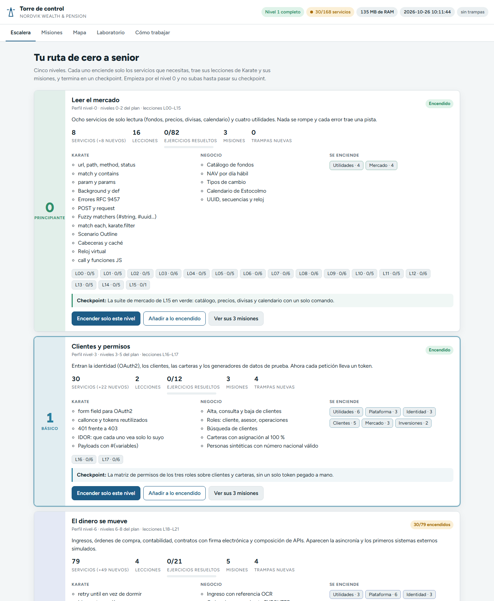
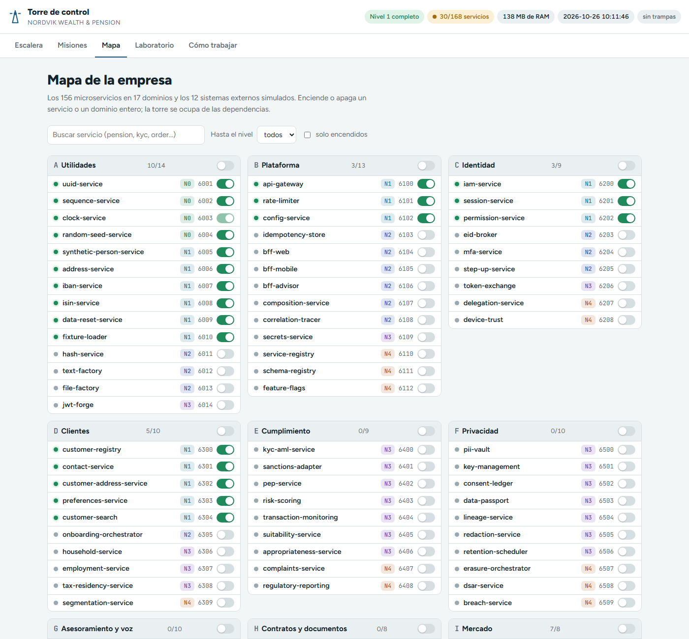

# 10 · Recorrido completo de principiante

Este capítulo junta todo en una sesión real: arrancas el nivel 0, abres la torre, haces la misión M01, haces la lección L00 con la academia y subes al nivel 1. Calcula una hora.

Las salidas que ves aquí son reales. Lo único que cambia en tu PC son PID, RAM, horas e identificadores `corr-...`.

---

## Parte A · Arrancar el nivel 0

### A1. Abre PowerShell en el proyecto

```powershell
cd D:\WORKSPACE_KARATE\nordvik
```

### A2. Arranca

```powershell
.\nordvik.cmd up -Nivel 0
```

Espera a ver la tabla de servicios. Los 8 deben estar `UP`:

```text
  Perfil nivel-0 · PID 28276 · RAM 233 MB (privada 146 MB) · 8 servicios encendidos
  Torre de control: http://localhost:3000  (enciende y apaga niveles, dominios y servicios)

Puerto Servicio            Salud Swagger
------ --------            ----- -------
  6001 uuid-service        UP    http://localhost:6001/swagger
  6002 sequence-service    UP    http://localhost:6002/swagger
  6003 clock-service       UP    http://localhost:6003/swagger
  6004 random-seed-service UP    http://localhost:6004/swagger
  6801 product-catalog     UP    http://localhost:6801/swagger
  6802 market-data         UP    http://localhost:6802/swagger
  6803 fx-rates            UP    http://localhost:6803/swagger
  6804 calendar-service    UP    http://localhost:6804/swagger
```

Si alguno sale `CAÍDO`, para aquí y mira [Problemas frecuentes](11-problemas-frecuentes.md).

---

## Parte B · Abrir la torre

### B1. Abre la Torre de control

```powershell
.\nordvik.cmd torre
```

Comprueba la barra superior: `Nivel 0 completo`, `8/168 servicios`, `sin trampas` y el reloj en hora real.


### B2. Lee la tarjeta del nivel 0

Fíjate en tres cosas:

- **Lecciones**: L00-L15, con chips `L00 · 0/5`, `L01 · 0/5`...
- **Misiones**: 3 (M01, M02, M03).
- **Checkpoint**: "La suite de mercado de L15 en verde: catálogo, precios, divisas y calendario con un solo comando." Es lo que tienes que conseguir antes de subir de nivel.

---

## Parte C · Misión M01: explorar el catálogo de fondos

### C1. Abre la misión

Pulsa **Ver sus 3 misiones** en la tarjeta del nivel 0 (o la pestaña **Misiones** y el filtro **Nivel 0 · Principiante**).


M01 ya dice **Lista: todo encendido** y el botón **Preparada**: con el nivel 0 tienes todo lo que necesita (`product-catalog` y `clock-service`).

### C2. Primer paso: la lista de fondos

Despliega **▶ 3 pasos** y pulsa **Probar** en el paso `GET /api/v1/funds`.

**Lo que ves.** Una ventana "GET /api/v1/funds" con "product-catalog respondió **200** · application/json; charset=utf-8" y el JSON: una lista `items` con los fondos y `total`.

Ahora la variante que propone el paso, desde la terminal:

```powershell
curl.exe "http://localhost:6801/api/v1/funds?category=EQUITY"
```

Respuesta: 7 fondos de renta variable (`"total":7`).

### C3. Segundo paso: un fondo concreto

Este paso tiene `{isin}` en la ruta, así que el botón es **Swagger**. Púlsalo, despliega `GET /api/v1/funds/{isin}`, **Try it out**, escribe `SE0000000001` y **Execute**.

**Lo que ves.** `200` con `"name":"Nordvik Global Equity"`, `"sri":4` y sus comisiones.

### C4. Tercer paso: las comisiones

En el mismo Swagger, `GET /api/v1/funds/{isin}/fees` con `SE0000000001`:

```json
{"isin":"SE0000000001","fees":[{"type":"MANAGEMENT","percent":"0.45"},{"type":"ENTRY","percent":"0.00"},{"type":"EXIT","percent":"0.00"}]}
```

### C5. El 404 de la historia de la misión

La misión pide "provocar un 404 con un ISIN inventado":

```powershell
curl.exe -i http://localhost:6801/api/v1/funds/SE9999999999
```

**Lo que ves.** `HTTP/1.1 404 Not Found`, `"code":"FUND_NOT_FOUND"` y un `hint` que te dice cómo listar los fondos que sí existen.

**Qué has aprendido.** Método, URL, parámetros, código de estado, JSON y error RFC 9457. Justo lo que entrena L00.

---

## Parte D · Lección L00 con la academia

### D1. Entra en la academia y lee la teoría

```powershell
cd D:\WORKSPACE_KARATE\nordvik\academia
.\academia.cmd leer L00
```

Lees "L00 · ¿Qué es una API?": la petición (método, URL, cabeceras, cuerpo), la respuesta (código, cabeceras, cuerpo), qué significan `2xx`, `4xx` y `5xx`, y cómo se escribe en Karate.

### D2. Ejecuta el ejemplo

```powershell
.\academia.cmd ejemplo L00
```

```text
 [OK] L00 · Ejemplo resuelto · L00 · Mi primera conversación con una API
```

Abre `lecciones\L00-que-es-una-api\ejemplo.feature` en VS Code. Son dos escenarios: el catálogo con `200` y un fondo inexistente con `404`. Es lo mismo que acabas de hacer en la misión.

### D3. Corrige sin haber hecho nada

```powershell
.\academia.cmd corregir L00
```

```text
══════════════════════════════════════════════════════════════════
 L00 · ¿Qué es una API?
══════════════════════════════════════════════════════════════════
 [  ] E01  El método para leer
        Qué ha pasado: Todavía quedan huecos ___ sin rellenar en este ejercicio.
        Pista: Leer en HTTP es el método más común de todos. Se escribe en minúsculas en Karate.
        Más pistas: academia pista L00 E01   ·   Detalle: target/academia/L00/E01/karate-summary.html
 [  ] E02  Predice el código de éxito
        Qué ha pasado: Todavía quedan huecos ___ sin rellenar en este ejercicio.
        Pista: Es el código de éxito más típico: empieza por 2.
        ...
 [  ] E05  Predice el código de una petición mal hecha
        Qué ha pasado: Todavía quedan huecos ___ sin rellenar en este ejercicio.
        Pista: Es el código de 'petición no válida': el primero de los 4xx.
        Más pistas: academia pista L00 E05   ·   Detalle: target/academia/L00/E05/karate-summary.html
──────────────────────────────────────────────────────────────────
 Resultado L00: 0/5  ░░░░░░░░░░░░░░░░░░░░ 0 %
 Rellena los huecos ___ que faltan y vuelve a ejecutar: academia corregir L00
 Progreso guardado en progreso.json · 2026-10-26T09:44:34
```

Es normal: es tu punto de partida.

### D4. Resuelve E01

Abre `lecciones\L00-que-es-una-api\ejercicios\E01.feature`:

```gherkin
@L00 @E01
Feature: L00 E01 · El método para leer

  Scenario: Leer la lista de fondos
    Given url catalogUrl
    And path '/api/v1/funds'
    When method ___
    Then status 200
```

**Predice antes de escribir:** para leer se usa... Cambia `___` por tu respuesta, guarda y corrige otra vez:

```powershell
.\academia.cmd corregir L00
```

```text
 [OK] E01  El método para leer
 [  ] E02  Predice el código de éxito
 ...
 Resultado L00: 1/5  ████░░░░░░░░░░░░░░░░ 20 %
```

Si fallas, pide la pista 2 (`.\academia.cmd pista L00 E01`) antes que la solución.

### D5. Resuelve E02 a E05

| Ejercicio | Qué te pide | Qué has visto en la misión que te ayuda |
| --- | --- | --- |
| E02 | El código de éxito de `GET /api/v1/funds` | Paso C2 |
| E03 | El ISIN de "Nordvik Global Equity" en la ruta | Paso C3 |
| E04 | El código de `SE9999999999` | Paso C5 |
| E05 | El código de `/api/v1/funds/hola` | [Capítulo 8, paso 4](08-swagger-y-primeras-peticiones.md) |

Cuando estén todos:

```text
══════════════════════════════════════════════════════════════════
 L00 · ¿Qué es una API?
══════════════════════════════════════════════════════════════════
 [OK] E01  El método para leer
 [OK] E02  Predice el código de éxito
 [OK] E03  Pide un fondo concreto
 [OK] E04  Predice el código de algo que no existe
 [OK] E05  Predice el código de una petición mal hecha
──────────────────────────────────────────────────────────────────
 Resultado L00: 5/5  ████████████████████ 100 %
 ¡Lección superada! Siguiente: academia leer L01
 Progreso guardado en progreso.json · 2026-10-26T09:53:09
```

### D6. Mira tu avance en la torre

Vuelve a la pestaña **Escalera** y recarga. En la tarjeta del nivel 0 el chip pasa a `L00 · 5/5` y "Ejercicios resueltos" a `5/82`.

---

## Parte E · El resto del nivel 0

Sigue la misma rutina con cada lección hasta L15, y con las misiones M02 (precio en día hábil) y M03 (viajar en el tiempo con el reloj virtual del [Laboratorio](06-laboratorio.md)).

| Lecciones | Misión que las practica |
| --- | --- |
| L00-L04 | M01 · Explorar el catálogo de fondos |
| L05, L06, L11 | M02 · Precio de un fondo en un día hábil |
| L12, L15 | M03 · Viajar en el tiempo |

El nivel termina cuando la suite de mercado de **L15** está en verde (el checkpoint).

---

## Parte F · Subir al nivel 1

### F1. Enciende el nivel 1

En la **Escalera**, en la tarjeta **1 · Básico · Clientes y permisos**, pulsa **Encender solo este nivel**. Lee la ventana ("Quedarán encendidos 30 servicios") y confirma.

**Lo que ves.** El aviso "Nivel 1: 22 encendidos, 0 apagados · 30 en marcha". La barra superior dice `Nivel 1 completo` y `30/168 servicios`. La tarjeta del nivel 1 pasa a **Encendido**.



### F2. Mira qué ha llegado

Abre el **Mapa** con el filtro **solo encendidos**. Han aparecido Plataforma (`api-gateway`, `rate-limiter`, `config-service`), Identidad (`iam-service`, `session-service`, `permission-service`), Clientes (5 servicios), Inversiones (`portfolio-service`, `allocation-engine`) y más utilidades (personas sintéticas, IBAN, ISIN...).



### F3. Empieza el nivel 1

- Lecciones: L16 (autenticación y roles) y L17 (IDOR y máscaras).
- Misiones: M04 (alta de un cliente), M05 (quién ve qué) y M06 (primera cartera).
- Novedad: desde ahora casi todas las peticiones llevan un **token** OAuth2 de `iam-service` (6200).

```powershell
cd D:\WORKSPACE_KARATE\nordvik\academia
.\academia.cmd leer L16
```

### F4. Al terminar la sesión

```powershell
cd D:\WORKSPACE_KARATE\nordvik
.\nordvik.cmd down
```

La próxima vez puedes arrancar directamente en tu nivel: `.\nordvik.cmd up -Nivel 1`.

Siguiente: [11 · Problemas frecuentes](11-problemas-frecuentes.md)
